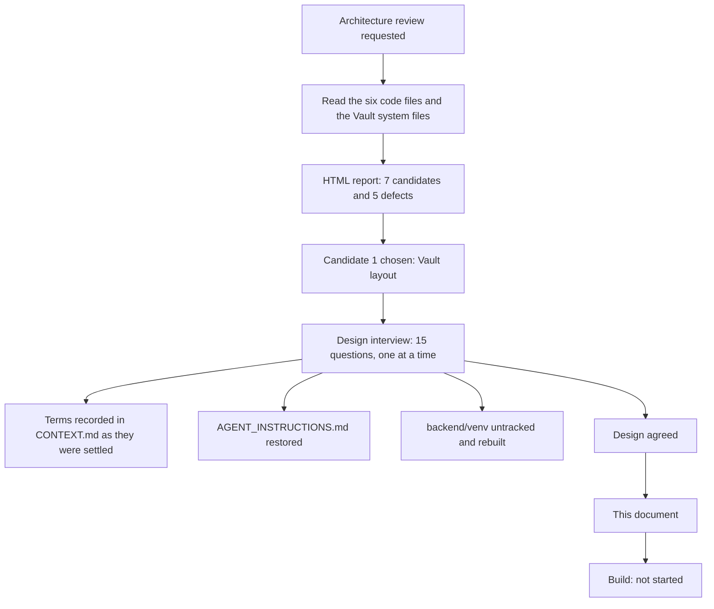

# Architecture Review and Vault Layout Design — 14 November 2026

This document records an architecture review of the repository and the design session that followed for the first candidate, the **Vault layout module**. It covers what was examined, every decision that was made, the options that were rejected and why, what was changed in the working tree, and what remains to be done.

Status at the time of writing: **design agreed, build not started, nothing committed.**

Domain terms used here (Vault, Zone, Hemisphere, Assets, Unmanaged directory, MOC, System file, Vault layout) are defined in [`CONTEXT.md`](../CONTEXT.md).

## Contents

1. [How the session went](#1-how-the-session-went)
2. [The review](#2-the-review)
3. [Design decisions for the Vault layout module](#3-design-decisions-for-the-vault-layout-module)
4. [Changes made during the session](#4-changes-made-during-the-session)
5. [Side question: storing a session in the Vault](#5-side-question-storing-a-session-in-the-vault)
6. [What the build will consist of](#6-what-the-build-will-consist-of)
7. [Open items](#7-open-items)

---

## 1. How the session went

| Step | What happened |
|---|---|
| Review | The six hand-written code files (about 2,870 lines) were read in full, along with `vault/CLAUDE.md`, `vault/SOUL.md`, `vault/MEMORY.md`, `README.md` and the deployment workflow. No sub-agent was used. |
| Report | A self-contained HTML report was written to the OS temp directory (`architecture-review-20261114-115732.html`). It is not in the repository and may be cleaned up by the operating system; section 2 below reproduces its findings. |
| Choice | Candidate 1 was chosen to start with. |
| Interview | Fifteen questions were asked one at a time, each with a recommendation. Where a question could be answered from the code or the Vault, it was answered by looking, not by asking. |
| Side effects | Decisions that changed the working tree were carried out as they were made (section 4). |

Gaps in the process, stated for the record:

- The review skill refers to a `/codebase-design` skill and a `/domain-modeling` skill. Neither was found on this machine, so the architecture vocabulary came from the report-format guide and `CONTEXT.md` was maintained by hand.
- There was no `CONTEXT.md` and there were no ADRs before this session.

---

## 2. The review

### 2.1 What was examined

| File | Lines | Role |
|---|---|---|
| `backend/vault_manager.py` | 457 | Engine CLI: scaffolding, templates, MOC updates, status, validation |
| `backend/query.py` | 381 | Engine CLI: Ledger compaction, Heartbeat, embedding and search |
| `backend/architect_generator.py` | 253 | Blueprint generator: creates new Vaults |
| `frontend/server.js` | 473 | Control Panel API server |
| `frontend/sessions.js` | 969 | Session Explorer: reads AI tool transcripts from five providers |
| `frontend/src/lib/vault.ts` | 337 | Control Panel browser-side data access |

There were no tests anywhere in the repository.

### 2.2 Candidates

| # | Candidate | Strength | Summary |
|---|---|---|---|
| 1 | One Vault layout module | Strong | The Hemisphere map was restated in six places that disagreed, and nothing prevented a write to the Left Hemisphere. |
| 2 | Explicit Session provider seam | Strong | Five providers are dispatched through four separate `if`/`switch` blocks in `sessions.js`; adding a provider means editing all four. |
| 3 | An owner for the Ledger and Heartbeat | Strong | `MEMORY.md` and `HEARTBEAT.md` are read and written by five pieces of code and by agents directly, each assuming its own format. |
| 4 | One MOC index module | Worth exploring | `update-moc` and `auto-update-moc` index notes in two different ways; frontmatter splitting is copied three times. |
| 5 | Deeper Knowledge Base index | Worth exploring | `embed` and `search` both branch on a flag returned by `get_connection`; neither can be tested without downloading a model. |
| 6 | One Vault reader for the Control Panel | Worth exploring | Seven endpoints each walk and parse the Vault themselves; the browser carries a third frontmatter parser. |
| 7 | A real seam between Engine and Control Panel | Speculative | Vault status is computed twice with different answers; Engine results reach the Control Panel only as console text. |

Candidate 1 was recommended first because it is the smallest change, the drift was already real, and candidates 3, 4, 6 and 7 depend on it.

### 2.3 Evidence for candidate 1

How the six copies disagreed before this session:

| Copy | `90_Assets` | `00_MOCs` | System files |
|---|---|---|---|
| `backend/vault_manager.py` | archive | Right | 5 |
| `frontend/server.js` | archive | Right | 7 |
| `frontend/src/lib/vault.ts` | archive | Right | not listed |
| `backend/architect_generator.py` | unclassified | unclassified | 5 |
| `.cursorrules` | Right (writable) | Right | 3 |
| `vault/SOUL.md` | not listed | not listed | not listed |

`vault/AGENT_INSTRUCTIONS.md`, restored during the session, is a seventh copy and omits five Right Hemisphere directories.

No code checked write permission: `create-folder` and `inject-template` accept any path, including one containing `..`.

### 2.4 Defects found while exploring

These were confirmed in the code. None is fixed by the Vault layout work unless noted.

| Location | Defect |
|---|---|
| `frontend/src/lib/vault.ts:240` | `API_BASE` is used but defined nowhere, so session backup from the Control Panel always fails with "API_BASE is not defined". |
| `backend/query.py:340` | The sqlite-vec query selects `sub.distance` with no `sub` alias, so that path always fails and the Python fallback always runs. |
| `backend/query.py:170-227` | `heartbeat` ticks all five checklist items unconditionally, including "Notify" and "Sync Knowledge Base", which only list files. |
| `backend/query.py:93-116` | `sync-notebooklm` prints "Successfully synced" without sending a request. |
| `backend/vault_manager.py:90-103` | The "last Rolling Log timestamp" expects bullets beginning `- [YYYY-MM-DD]`. Nothing wrote that format before this session. |
| `frontend/server.js:204` | The path guard uses `startsWith(vaultPath)`, which also accepts a sibling directory such as `vault-backup`. |
| `frontend/server.js:436-444` | The Orchestrator endpoint builds a shell string for `exec`. The server listens on `0.0.0.0`. |
| `frontend/sessions.js:960-967` | `POST /api/sessions/backup` writes to any path the caller names. |
| `frontend/server.js:49` | `/api/files` serves every Markdown file under the Vault, including `Connections/`. Decision 4 below addresses this. |
| Repository | `backend/venv` (6,647 files) and `__pycache__` were tracked in git. Addressed during the session (section 4). |

---

## 3. Design decisions for the Vault layout module

Each entry gives the question, the options, the decision and the reason. "Recommended" marks the option proposed during the interview.

### Decision 1 — Zone and write permission are separate facts

**Question.** Can agents write to `90_Assets`, and is it a Hemisphere at all?

**Evidence.** The code called it "archive"; `.cursorrules` listed it as Right Hemisphere with read/write; `SOUL.md` did not mention it and named four archive directories that do not exist (`80_Human_Templates`, `81_Snippets`, `82_Images`, `90_Archive`); `Assets_MOC.md` tells agents to append new assets.

| Option | Outcome |
|---|---|
| Make `90_Assets` part of the Right Hemisphere | Rejected |
| Keep it as its own Zone and record write permission separately (recommended) | **Chosen** |

**Decision.** Every directory has a Zone (Left Hemisphere, Right Hemisphere or Assets) and, separately, a write permission. `90_Assets` is the Assets Zone and is agent-writable. The four non-existent archive directories are removed from `SOUL.md`.

**Consequence.** "Right Hemisphere" is no longer shorthand for "agent-writable"; the write rule is checked per directory.

### Decision 2 — The layout belongs to each Vault

**Question.** Does the layout belong to the repository or to each Vault?

**Evidence.** The Engine CLIs are hard-wired to `vault/`; the Control Panel reads whichever Vault `VAULT_PATH` names; the generator already writes a `vault.config.yaml` into each generated Vault, holding provenance only.

| Option | Outcome |
|---|---|
| Per repository: one layout for every Vault | Rejected. A generated Vault that gains a directory could not say so. |
| Per Vault: a data file in the Vault root (recommended) | **Chosen** |

**Decision.** Each Vault carries its own layout. The Blueprint in `vault/` has one, and generated Vaults inherit it.

**Note.** The recommendation named `vault.config.yaml` as the file. The answer given was "per vault", which was taken to accept the file name as well.

### Decision 3 — A missing or invalid layout fails loudly

**Question.** What happens when a Vault has no layout, or an invalid one?

| Option | Outcome |
|---|---|
| Fall back to a built-in default | Rejected. The default would be another copy of the layout in code, and a Vault could be classified by a layout it does not have. |
| Fail loudly (recommended) | **Chosen** |

**Decision.** The Engine exits non-zero with a message naming the file and what is wrong. The Control Panel shows the same error instead of a dashboard. No layout exists anywhere except in a Vault.

**Consequence.** The Blueprint generator refuses to generate without a Blueprint that has a valid layout. Its hard-coded fallback blocks (`architect_generator.py:22-153`) are deleted.

### Decision 4 — Unmanaged directories, and default deny for anything undeclared

**Question.** How should the layout treat directories it does not declare?

**Evidence.** The Blueprint contains `copilot/` (created by the Obsidian Copilot plugin), `Connections/` (contains a `Tokens` entry, which was not opened) and several dot-directories. `validate` ignored them; the Control Panel's `/api/files` read every Markdown file in them. Both named directories are untracked in git.

| Option | Outcome |
|---|---|
| Tolerate silently | Rejected |
| Declare as unmanaged, with default deny (recommended) | **Chosen** |
| Reject any undeclared directory | Rejected |

**Decision.**

- `copilot` and `Connections` are named in the layout as unmanaged: the Engine never writes there and the Control Panel never reads there.
- Dot-directories are always ignored without being listed.
- Any other undeclared directory: agents may not write there, the Control Panel does not read it, and `validate` reports it.

### Decision 5 — A subdirectory can override its parent's permission

**Question.** Is write permission set per top-level directory only?

**Evidence.** `SOUL.md` allows agents to write to the `Reviews/` subfolder of the Left Hemisphere under the `/weekly-review` protocol. The generator creates `01_Journal/Reviews`. No code knew of the exception.

| Option | Outcome |
|---|---|
| Top-level only; weekly reviews move to a Right Hemisphere directory | Rejected |
| Subdirectory override, most specific entry wins (recommended) | **Chosen** |

**Decision.** `01_Journal/Reviews` is agent-writable and remains Left Hemisphere for display. It is the only override.

**Note.** The question offered two options and the answer was "yes". It was taken as acceptance of the recommendation and stated as such at the time; it can be reversed.

### Decision 6 — System files and their permissions

**Question.** Which root files are system files, and which may agents write?

| File | Required | Agent-writable |
|---|---|---|
| `MEMORY.md` | yes | yes |
| `HEARTBEAT.md` | yes | yes |
| `CLAUDE.md` | yes | no |
| `SOUL.md` | yes | no |
| `USER.md` | yes | no |
| `README.md` | no | no |
| `AGENT_INSTRUCTIONS.md` | no | no |

Any other Markdown file at the Vault root is a validation failure, as before.

**On `AGENT_INSTRUCTIONS.md`.** The file was deleted in the working tree, uncommitted. The deletion was not remembered and was believed to be unintentional. The committed version was inspected: it is an earlier form of `.cursorrules`, lists six Right Hemisphere directories and omits five, tells agents to run `node scripts/update_moc.js` (which does not exist), and defines `/new` and `/today` commands. Nothing reads it. The recommendation was to leave it deleted; **the decision was to restore it**, and it was restored from git.

**Known trade-off.** With `USER.md` read-only, an agent cannot update the user profile through the Engine when asked.

### Decision 7 — Prose copies are checked, not generated

**Question.** What happens to the prose copies of the layout in `.cursorrules`, `vault/SOUL.md` and `vault/AGENT_INSTRUCTIONS.md`?

| Option | Outcome |
|---|---|
| Hand-maintain | Rejected. This is how they drifted. |
| Generate from the layout | Rejected. The Engine would be writing files that are read-only to agents, and it adds a command to remember. |
| Check in `validate` (recommended) | **Chosen** |
| Replace the lists with a pointer to the layout | Rejected. Agents follow a list they can see more reliably than one they must fetch. |

**Decision.** The three files stay hand-written. `validate` fails if a directory list in any of them disagrees with the layout. They are corrected by hand once, as part of the build, so the check passes from the start.

### Decision 8 — Enforcement in Engine commands only

**Question.** Where is write permission actually enforced?

**Evidence.** Writes reach the Vault through Engine commands or through an agent editing files with its own tools. The Engine never sees the second kind.

| Option | Outcome |
|---|---|
| Engine commands only (recommended) | **Chosen** |
| Engine commands plus an editor hook that blocks direct edits | Deferred |

**Decision.** Every Engine command that writes asks the layout first, and refuses read-only paths, undeclared directories, unmanaged directories and anything resolving outside the Vault. The permission check is also exposed as an Engine command that exits non-zero when the answer is no, so a hook can be added cheaply later.

**Accepted consequences.**

- A human running a write command against a read-only path is refused too; the Engine cannot tell who is calling.
- The guarantee is partial. Until a hook exists, the rule is enforced for Engine writes and only requested, in prose, for direct edits.

The hook will be re-evaluated after the build has been tested.

### Decision 9 — The Control Panel reads the file directly

**Question.** How does the Control Panel get the layout?

**Evidence.** `server.js` and `vault.ts` each hold their own lists. The Control Panel needs only display facts: Zone per directory, the system file list and what to skip. `js-yaml` is installed as a dependency of `gray-matter` and would need declaring directly.

| Option | Outcome |
|---|---|
| Ask the Engine by shelling out to Python | Rejected. Every request pays for a Python start, and the Control Panel breaks when the venv does. |
| Read `vault.config.yaml` directly (recommended) | **Chosen** |

**Decision.**

- The Engine (Python) owns the rules: it validates the file's shape and answers the permission question.
- The Control Panel (JavaScript) has a small reader for display facts only. It fails loudly if the file is missing or lacks the fields it uses, and does not re-implement validation or permissions.
- The server exposes the layout at one endpoint; the browser fetches it from there. The lists in `server.js` and `vault.ts` are deleted.
- GitHub Pages, which has no server, is left as it is: files only, with no Zones from the layout.

### Decision 10 — The layout says which MOC each directory is indexed in

**Question.** Should the layout also record each directory's MOC?

**Decision.** Yes.

### Decision 11 — A MOC is optional but must be stated

**Question.** Must every agent-writable directory have a MOC?

**Evidence.**

| Directory | MOC before this session |
|---|---|
| `10_Repositories` | `Repositories_MOC.md` |
| `20_DevOps` | `DevOps_MOC.md` |
| `30_Git` | `Git_MOC.md` |
| `90_Assets` | `Assets_MOC.md`, though `auto-update-moc` did not route to it |
| `15_Prototype_Designs`, `25_Knowledge_Base`, `40_Agent_Skills`, `50_Databases`, `60_Canvas_Maps`, `80_Templates` | none |

| Option | Outcome |
|---|---|
| Required: six new MOCs must be created | Rejected |
| Optional but explicit (recommended) | **Chosen** |

**Decision.**

- Each directory either names its MOC or is marked as not indexed. Saying nothing is a validation failure.
- The four existing MOCs are recorded, including `Assets_MOC.md`. The six other directories are marked not indexed.
- `validate` checks that every MOC the layout names exists.
- `auto-update-moc` looks up the MOC file from the layout. Its per-directory entry formatting and duplicate check stay as they are; reworking those belongs to candidate 4.
- The sentence in `.cursorrules` becomes "index it in its MOC if the layout names one".

### Decision 12 — An explicit Vault root

**Question.** Which Vault do the Engine commands act on?

**Evidence.** The Engine hard-codes the repository's `vault/`. The Control Panel follows `VAULT_PATH`. If `VAULT_PATH` points elsewhere, the Control Panel shows one Vault while its Orchestrator page runs Engine commands against another.

| Option | Outcome |
|---|---|
| Keep the path fixed | Rejected |
| Explicit Vault root (recommended) | **Chosen** |

**Decision.** The layout module is given a Vault root and does not know where it came from. The CLIs resolve the root once: `VAULT_PATH` if set, otherwise the repository's `vault/`. Every Engine command prints the root it resolved as its first line, so a stale `VAULT_PATH` is visible.

### Decision 13 — Untrack the virtual environment, rebuild it, and add tests

**Question.** What is done about the Python environment so that tests can run?

**Evidence.** `backend/venv` pointed at a Python 3.11 installation that no longer exists. It was committed to git (6,647 files) and not excluded by `.gitignore`. Python 3.12 and 3.13 are installed. `pytest` is not in `requirements.txt`.

| Option | Outcome |
|---|---|
| Rebuild in place, leave it tracked | Rejected |
| Untrack, then rebuild (recommended) | **Chosen, and carried out** |

**Decision on tests.**

- Engine: `pytest`, listed in a development requirements file. Tests build a small Vault in a temp directory and cover Zone lookup, the permission question (including the `01_Journal/Reviews` override and paths that escape the Vault), the loud failures and the MOC lookup.
- Control Panel reader: Node's built-in test runner, covering the display facts and the loud failure.

### Decision 14 — Existing broken links are left alone

**Question.** `validate` already fails on the Blueprint. How is that baseline treated?

**Evidence.** After the venv was rebuilt, `validate` exited 1 with ten broken wikilinks:

| MOC | Broken link |
|---|---|
| `Agent_SOP.md` | `[]` (false positive: not a link) |
| `Assets_MOC.md` | `[[Filename.ext]]` (false positive: a format example) |
| `DevOps_MOC.md` | `[[20_DevOps/github-actions-deploy]]` |
| `DevOps_MOC.md` | `[[20_DevOps/gitlab-ci-test]]` |
| `DevOps_MOC.md` | `[[20_DevOps/terraform-aws-core]]` |
| `DevOps_MOC.md` | `[[20_DevOps/k8s-cluster-config]]` |
| `Git_MOC.md` | `[[30_Git/Git - Feature Branching]]` |
| `Repositories_MOC.md` | `[[10_Repositories/api-gateway]]` |
| `Repositories_MOC.md` | `[[10_Repositories/auth-service]]` |
| `Repositories_MOC.md` | `[[10_Repositories/frontend-web]]` |

| Option | Outcome |
|---|---|
| Fix the links first | Rejected. It edits MOC content and the link matcher, which is candidate 4's territory. |
| Leave them and separate the output (recommended) | **Chosen** |

**Decision.** `validate` reports layout checks and MOC link checks as two named sections, each with its own pass or fail. Success for this work is "the layout section passes and the layout tests pass". The overall exit code stays 1 until the links are dealt with.

**Note.** The question offered two options and the answer was "yes". It was taken as acceptance of the recommendation.

### Decision 15 — No migration; start clean

**Question.** What about Vaults generated before this change?

| Option | Outcome |
|---|---|
| A migration command that copies the layout from the Blueprint | Rejected |
| No command, a precise error message (recommended) | **Chosen** |

**Decision.** There are no older generated Vaults in use. The one existing external Vault, the Knowledge Vault, is large and will have its own analysis. The build assumes a clean start. The generator copies the layout from the Blueprint into each new Vault's `vault.config.yaml`, alongside the provenance fields it already writes.

---

## 4. Changes made during the session

Nothing below is committed.

| Change | Detail |
|---|---|
| `CONTEXT.md` created | Repository root. Defines Vault, Zone, Left Hemisphere, Right Hemisphere, Assets, Write permission, Unmanaged directory, Undeclared directory, MOC, System file and Vault layout. |
| `vault/AGENT_INSTRUCTIONS.md` restored | `git restore`; identical to the committed version. |
| `backend/venv` and `backend/__pycache__` untracked | `git rm -r --cached`: 6,650 staged deletions. The files remain on disk. |
| `.gitignore` updated | Added `backend/venv/`, `__pycache__/` and `*.pyc`. |
| `backend/venv` rebuilt | Python 3.13.14, installed from `backend/requirements.txt`. The Engine CLIs run again. |
| `vault/MEMORY.md` updated | Two Rolling Log entries added for this session; compacted with `query.py compact`. |
| `docs/architecture-review-2026-11-14.md` | This document. |

Not done, and worth knowing:

- The optional search packages (`fastembed`, `numpy`, `sqlite-vec`) are commented out in `requirements.txt` and were not installed, so `query.py embed` and `query.py search` do not work in the rebuilt environment.
- `requirements.txt` has no version numbers, so a rebuild on another day can produce a different environment.

---

## 5. Side question: storing a session in the Vault

During the interview a separate question came up: how to direct an agent to record a troubleshooting session (a GitKraken hooks problem, investigated in another chat) in the Vault.

The guidance given:

- **Where:** `vault/30_Git/Git - GitKraken Hooks Troubleshooting.md`, indexed under "Static Agent Index" in `vault/00_MOCs/Git_MOC.md`, with a dated bullet in the Rolling Log.
- **Template:** start from `Git_Resource_Template.md` for the frontmatter, but replace its body sections with Problem, Symptoms, Root Cause, Fix, How to Verify and Open Questions, and ask the agent to separate confirmed findings from guesses.
- **Manual steps:** at that moment `inject-template` and `auto-update-moc` could not run because the venv was broken, so the prompt asked the agent to create the file and the MOC line by hand.

Observations that came out of it:

- `Git_Resource_Template.md` is shaped for describing a tool, not for a problem write-up. A dedicated troubleshooting template would be worth adding if more such notes are expected.
- Only `25_Knowledge_Base/` is indexed for semantic search, so a note in `30_Git/` is found through its MOC and Obsidian search, not through `query.py search`.

The other agent's entry subsequently appeared in the Rolling Log, recording that the note was written and indexed.

---

## 6. What the build will consist of

Agreed order, so that each step can be checked on its own:

1. **Engine module and tests.** The Vault layout module in Python, reading `vault.config.yaml` from an explicit Vault root, with `pytest` tests. The Blueprint's `vault/vault.config.yaml` is written with the layout agreed above.
2. **Engine commands.** `create-folder`, `inject-template`, `update-moc` and `auto-update-moc` ask the layout before writing. `validate` and `vault-status` take directories, Zones and system files from it; `validate` gains the prose check and the separated output. `auto-update-moc` routes from it. A permission-check command is added. The Vault root is resolved from `VAULT_PATH` and printed. The constant lists in `vault_manager.py` are deleted.
3. **Blueprint generator.** Creates directories from the layout, copies the layout into the new Vault's `vault.config.yaml`, and refuses to run without a valid Blueprint layout. The hard-coded fallback blocks are deleted.
4. **Control Panel.** A small reader in the server, one endpoint exposing the layout, the lists in `server.js` and `vault.ts` deleted, unmanaged and undeclared directories no longer read, and a Node test for the reader. `js-yaml` declared in `package.json`.
5. **Prose.** `.cursorrules`, `vault/SOUL.md` and `vault/AGENT_INSTRUCTIONS.md` corrected by hand so the new check passes.

The layout the Blueprint will carry:

| Directory | Zone | Agent-writable | MOC |
|---|---|---|---|
| `01_Journal` | Left Hemisphere | no | not indexed |
| `01_Journal/Reviews` | Left Hemisphere | yes (override) | not indexed |
| `02_Human_Thoughts` | Left Hemisphere | no | not indexed |
| `00_MOCs` | Right Hemisphere | yes | not indexed |
| `10_Repositories` | Right Hemisphere | yes | `Repositories_MOC.md` |
| `15_Prototype_Designs` | Right Hemisphere | yes | not indexed |
| `20_DevOps` | Right Hemisphere | yes | `DevOps_MOC.md` |
| `25_Knowledge_Base` | Right Hemisphere | yes | not indexed |
| `30_Git` | Right Hemisphere | yes | `Git_MOC.md` |
| `40_Agent_Skills` | Right Hemisphere | yes | not indexed |
| `50_Databases` | Right Hemisphere | yes | not indexed |
| `60_Canvas_Maps` | Right Hemisphere | yes | not indexed |
| `80_Templates` | Right Hemisphere | yes | not indexed |
| `90_Assets` | Assets | yes | `Assets_MOC.md` |
| `copilot`, `Connections` | unmanaged | no | — |

The MOC entries for the Left Hemisphere directories and `00_MOCs` were not discussed individually; "not indexed" is the assumption, consistent with decision 11.

---

## 7. Open items

| Item | State |
|---|---|
| Go-ahead to start the build | Not yet given |
| Whether to commit the venv untracking on its own first | Not yet answered |
| `AGENT_INSTRUCTIONS.md` and the prose check | The restored file will fail the check until its directory lists are corrected. Proposed: correct only the lists, and leave the rest, including the dead `scripts/update_moc.js` reference, for a separate decision. Not yet confirmed. |
| Editor hook for direct agent edits | Deferred until the build has been tested (decision 8) |
| The ten broken MOC links | Left for candidate 4 (decision 14) |
| Analysis of the Knowledge Vault | Separate piece of work (decision 15) |
| Pinning `requirements.txt` | Raised, not decided |
| Troubleshooting note template | Suggested, not decided |
| Candidates 2 to 7 and the defects in section 2.4 | Not started |
