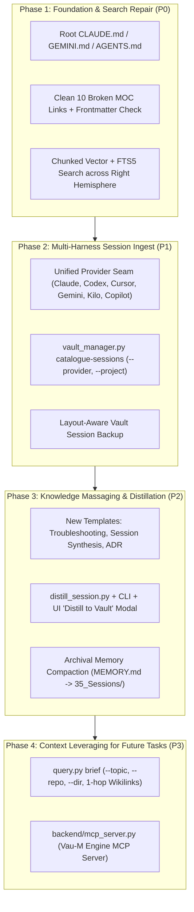

# Implementation Plan: Vau-M Knowledge Lifecycle (Ingest, Massage, Index & Leverage)

> **2026-11-15 review update:** this is the original implementation plan. The [objective review](../vault/01_Journal/Reviews/2026-11-15%20-%20Knowledge%20Lifecycle%20Objective%20Review.md) found material gaps despite passing tests. The proposed next increment is [PRD VAUM-KLC-001](prd-knowledge-lifecycle-correctness.md), pending explicit approval; earlier completion statements are not acceptance evidence for that increment.

## Goal
Transform Vau-M from a structural vault blueprint and passive session browser into a full-lifecycle knowledge engine that ingests multi-harness LLM/agent sessions, massages raw transcripts into structured Vault notes, indexes the entire Right Hemisphere with chunked hybrid search, and serves tailored context briefings back into future agent tasks.

## Architecture



## Tech Stack
- **Backend / Engine:** Python 3.13, `typer`, `rich`, `pyyaml`, `python-dotenv`, `sqlite3` (FTS5 + `sqlite-vec`), `fastembed`, `numpy`, `mcp` (FastMCP)
- **Frontend / Control Panel:** Node.js 20+, Express, React 19, TypeScript, Vite, Tailwind CSS, `better-sqlite3`, `js-yaml`
- **Testing:** `pytest` (`backend/tests/`), Node built-in test runner (`node --test` in `frontend/`)

---

## Phase 1: Foundation, Bootloaders & Right-Hemisphere Search (P0)

### Task 1.1: Populate Root Agent Bootloaders (`CLAUDE.md`, `GEMINI.md`, `AGENTS.md`)

**Files:**
- Modify: `CLAUDE.md`
- Modify: `GEMINI.md`
- Modify: `AGENTS.md`
- Modify: `backend/tests/test_vault_layout.py`

**Step 1: Write failing test**
```python
# Append to backend/tests/test_vault_layout.py
def test_root_agent_bootloaders_have_no_unfilled_placeholders():
    repo_root = Path(__file__).resolve().parent.parent.parent
    for name in ("CLAUDE.md", "GEMINI.md", "AGENTS.md"):
        text = (repo_root / name).read_text(encoding="utf-8")
        assert "<fill in>" not in text, f"{name} still contains <fill in>"
        assert "<build>" not in text, f"{name} still contains <build>"
        assert "backend/vault_manager.py" in text, f"{name} does not reference backend/vault_manager.py"
        assert "vault/vault.config.yaml" in text, f"{name} does not reference vault/vault.config.yaml"
```

**Step 2: Verify test failure**
```powershell
.\backend\venv\Scripts\python.exe -m pytest backend\tests\test_vault_layout.py -k "bootloaders" -q
# Expected: FAIL - AssertionError: CLAUDE.md still contains <fill in>
```

**Step 3: Implement minimal code**
Update `CLAUDE.md`, `GEMINI.md`, and `AGENTS.md` to replace template placeholders (`<fill in>`, `@src/index.ts`, `<build>`, `<test>`, `<run>`) with the real stack (`Python 3.13 Engine + Node/Express/React Control Panel + Obsidian Blueprint Vault`), file map (`@vault/vault.config.yaml`, `@CONTEXT.md`, `@backend/vault_manager.py`, `@backend/query.py`, `@frontend/server.js`, `@frontend/sessions.js`), and verification commands.

**Step 4: Verify test passes**
```powershell
.\backend\venv\Scripts\python.exe -m pytest backend\tests\test_vault_layout.py -k "bootloaders" -q
# Expected: 1 passed
```

**Step 5: Commit**
```powershell
git add CLAUDE.md GEMINI.md AGENTS.md backend/tests/test_vault_layout.py
git commit -m "docs: populate root CLAUDE.md, GEMINI.md, and AGENTS.md bootloaders"
```

---

### Task 1.2: Fix Broken MOC Wikilinks & False-Positive Link Extraction

**Files:**
- Modify: `backend/vault_manager.py`
- Modify: `vault/00_MOCs/Assets_MOC.md`
- Modify: `vault/00_MOCs/DevOps_MOC.md`
- Modify: `vault/00_MOCs/Git_MOC.md`
- Modify: `vault/00_MOCs/Repositories_MOC.md`
- Test: `backend/tests/test_vault_layout.py`

**Step 1: Write failing test**
```python
# Append to backend/tests/test_vault_layout.py
from vault_manager import _extract_wikilinks, _validate_mocs

def test_extract_wikilinks_ignores_fenced_code_and_inline_code():
    sample = (
        "Real link: [[30_Git/Git - Hotfix Workflow]]\n"
        "Inline example: `[[Filename.ext]]`\n"
        "```markdown\n"
        "- [[Fake Link Inside Code Fence]]\n"
        "```\n"
    )
    assert _extract_wikilinks(sample) == ["30_Git/Git - Hotfix Workflow"]

def test_blueprint_mocs_have_zero_broken_links():
    results = _validate_mocs(BLUEPRINT_VAULT)
    broken = [(r["moc"], r["broken_links"]) for r in results if r["broken_links"]]
    assert broken == []
```

**Step 2: Verify test failure**
```powershell
.\backend\venv\Scripts\python.exe -m pytest backend\tests\test_vault_layout.py -k "wikilinks or broken_links" -q
# Expected: FAIL - 2 failed
```

**Step 3: Implement minimal code**
```python
# In backend/vault_manager.py, update _extract_wikilinks:
_FENCED_CODE = re.compile(r"```[\s\S]*?```", re.MULTILINE)
_INLINE_CODE = re.compile(r"`[^`\n]+`")

def _extract_wikilinks(text: str) -> list[str]:
    """Extract all [[wikilink]] targets from text outside code blocks and inline code."""
    cleaned = _FENCED_CODE.sub("", text)
    cleaned = _INLINE_CODE.sub("", cleaned)
    return [
        m.strip()
        for m in re.findall(r"\[\[([^\[\]|]+?)(?:\|[^\[\]]*?)?\]\]", cleaned)
        if m.strip()
    ]
```
And update `vault/00_MOCs/DevOps_MOC.md`, `vault/00_MOCs/Git_MOC.md`, and `vault/00_MOCs/Repositories_MOC.md` so their `## Static Agent Index` entries point to the actual notes in `vault/20_DevOps/`, `vault/30_Git/`, and `vault/10_Repositories/` (and wrap `[[Filename.ext]]` in backticks in `Assets_MOC.md`).

**Step 4: Verify test passes**
```powershell
.\backend\venv\Scripts\python.exe -m pytest backend\tests\test_vault_layout.py -k "wikilinks or broken_links" -q
.\backend\venv\Scripts\python.exe backend\vault_manager.py validate
# Expected: PASS: Layout checks, PASS: MOC link checks (exit code 0)
```

**Step 5: Commit**
```powershell
git add backend/vault_manager.py backend/tests/test_vault_layout.py vault/00_MOCs/
git commit -m "fix(engine): ignore code spans in wikilink extractor and resolve blueprint MOC links"
```

---

### Task 1.3: Unify MOC Indexing & Add Frontmatter Validation to `validate`

**Files:**
- Modify: `backend/vault_manager.py`
- Modify: `vault/vault.config.yaml`
- Create: `vault/00_MOCs/Knowledge_Base_MOC.md`
- Test: `backend/tests/test_vault_layout.py`

**Step 1: Write failing test**
```python
# Append to backend/tests/test_vault_layout.py
from vault_manager import _check_frontmatter_problems

def test_check_frontmatter_reports_unparseable_yaml(tmp_path):
    bad_note = tmp_path / "bad.md"
    bad_note.write_text("---\ntitle: [unclosed\n---\nBody\n", encoding="utf-8")
    issues = _check_frontmatter_problems(tmp_path, [bad_note])
    assert len(issues) == 1
    assert "bad.md" in issues[0]
```

**Step 2: Verify test failure**
```powershell
.\backend\venv\Scripts\python.exe -m pytest backend\tests\test_vault_layout.py -k "test_check_frontmatter" -q
# Expected: FAIL - ImportError: cannot import name '_check_frontmatter_problems'
```

**Step 3: Implement minimal code**
1. Create `vault/00_MOCs/Knowledge_Base_MOC.md` and set `25_Knowledge_Base: { zone: right, agent_writable: true, moc: Knowledge_Base_MOC.md }` in `vault/vault.config.yaml`.
2. Add `_check_frontmatter_problems(vault_root: Path, notes: list[Path]) -> list[str]` in `backend/vault_manager.py` and include it as a check in `validate()`.
3. Route `update_moc` and `auto_update_moc` through a single helper `_append_to_moc_index(moc_path: Path, entry_line: str, link_target: str) -> bool` so all MOC updates land consistently under `## Static Agent Index`.

**Step 4: Verify test passes**
```powershell
.\backend\venv\Scripts\python.exe -m pytest backend\tests -q
.\backend\venv\Scripts\python.exe backend\vault_manager.py validate
# Expected: all tests pass, validate exits 0
```

**Step 5: Commit**
```powershell
git add backend/vault_manager.py backend/tests/test_vault_layout.py vault/vault.config.yaml vault/00_MOCs/Knowledge_Base_MOC.md
git commit -m "feat(engine): add Knowledge_Base_MOC, frontmatter validation, and unified MOC indexer"
```

---

### Task 1.4: Build Chunked Hybrid Search (`FTS5` + Vector) Across All Right Hemisphere Notes

> [!IMPORTANT]
> This replaces whole-file embedding on `25_Knowledge_Base/` only with heading-level markdown chunking across all Right Hemisphere directories (`10_Repositories`, `15_Prototype_Designs`, `20_DevOps`, `25_Knowledge_Base`, `30_Git`, `35_Sessions`, `40_Agent_Skills`), fixes the broken `sub.distance` SQL query, and adds SQLite FTS5 keyword search so search works even before/without downloading an embedding model.

**Files:**
- Create: `backend/knowledge_index.py`
- Modify: `backend/query.py`
- Create: `backend/tests/test_knowledge_index.py`

**Step 1: Write failing test**
```python
# backend/tests/test_knowledge_index.py
import sys
from pathlib import Path
sys.path.insert(0, str(Path(__file__).resolve().parent.parent))

from knowledge_index import chunk_markdown_note, index_vault_notes, search_vault_notes

SAMPLE_NOTE = """---
type: troubleshooting
tags: [git, hooks, gitkraken]
status: active
---

# GitKraken Hooks Troubleshooting

## Problem
Husky pre-commit hooks fail inside GitKraken GUI on Windows.

## Root Cause
PATH does not include the nvm node binary directory when launched from desktop.

## Fix
Set core.hooksPath and export PATH in ~/.huskyrc.
"""

def test_chunk_markdown_splits_by_h2_and_preserves_frontmatter():
    chunks = chunk_markdown_note("30_Git/Git - GitKraken.md", SAMPLE_NOTE)
    assert len(chunks) == 3
    assert chunks[0].heading == "Problem"
    assert chunks[0].doc_type == "troubleshooting"
    assert "gitkraken" in chunks[0].tags
    assert "Husky pre-commit" in chunks[0].content

def test_fts_search_finds_notes_across_right_hemisphere_without_embedder(tmp_path):
    db_path = tmp_path / "index.db"
    chunks = chunk_markdown_note("30_Git/Git - GitKraken.md", SAMPLE_NOTE)
    index_vault_notes(db_path, chunks, embed_fn=None)

    hits = search_vault_notes(db_path, "Husky pre-commit", directory="30_Git", limit=5, embed_fn=None)
    assert len(hits) >= 1
    assert hits[0].path == "30_Git/Git - GitKraken.md"
    assert hits[0].heading == "Problem"
```

**Step 2: Verify test failure**
```powershell
.\backend\venv\Scripts\python.exe -m pytest backend\tests\test_knowledge_index.py -q
# Expected: FAIL - ModuleNotFoundError: No module named 'knowledge_index'
```

**Step 3: Implement minimal code**
Create `backend/knowledge_index.py` with:
- `NoteChunk` dataclass (`chunk_id`, `path`, `directory`, `title`, `heading`, `doc_type`, `tags`, `content`)
- `chunk_markdown_note(rel_path: str, raw_text: str) -> list[NoteChunk]` (splits on `## ` headings, falls back to single chunk if no `## ` exists, extracts YAML frontmatter `type` and `tags`)
- SQLite schema with `note_chunks`, `note_chunks_fts` (FTS5 virtual table), and optional `vec_chunks` (`sqlite-vec` with valid `SELECT v.chunk_id, v.distance FROM vec_chunks v WHERE v.embedding MATCH ? AND k = ?`)
- `search_vault_notes(db_path, query, directory=None, tag=None, limit=5, embed_fn=None)` combining FTS5 BM25 ranking + vector cosine similarity when `embed_fn` is available.
Update `backend/query.py` (`embed` and `search` commands) to use `knowledge_index.py` across all Right Hemisphere directories declared in `VaultLayout`.

**Step 4: Verify test passes**
```powershell
.\backend\venv\Scripts\python.exe -m pytest backend\tests\test_knowledge_index.py -q
# Expected: 2 passed
```

**Step 5: Commit**
```powershell
git add backend/knowledge_index.py backend/query.py backend/tests/test_knowledge_index.py
git commit -m "feat(search): add chunked FTS5 and vector indexing across all Right Hemisphere directories"
```

---

## Phase 2: Multi-Harness Session Discovery & Cataloguing (P1)

### Task 2.1: Extract Unified Python Session Provider Readers (All 6 Harnesses)

> [!NOTE]
> Currently, only `frontend/sessions.js` knows how to read Claude, Codex, Cursor, Gemini, and Kilo Code sessions, and it truncates message content at 1,000–5,000 characters. This task creates a clean provider seam in Python (`backend/session_providers.py`) that reads full untruncated transcripts (including `transcript_full.jsonl` fallback for Gemini) so the Engine can catalogue and distill sessions from every harness.

**Files:**
- Create: `backend/session_providers.py`
- Create: `backend/tests/test_session_providers.py`

**Step 1: Write failing test**
```python
# backend/tests/test_session_providers.py
import json
import sys
from pathlib import Path
sys.path.insert(0, str(Path(__file__).resolve().parent.parent))

from session_providers import (
    discover_claude_sessions,
    discover_codex_sessions,
    discover_gemini_sessions,
    read_session_transcript,
)

def test_discover_and_read_claude_jsonl_session(tmp_path):
    proj_dir = tmp_path / "D--Repos-my-app"
    proj_dir.mkdir()
    session_file = proj_dir / "sess-123.jsonl"
    session_file.write_text(
        json.dumps({"type": "human", "message": "Fix the login bug", "timestamp": "2026-11-14T10:00:00Z"}) + "\n"
        + json.dumps({"type": "assistant", "message": "Root cause is token expiry.", "timestamp": "2026-11-14T10:01:00Z"}) + "\n",
        encoding="utf-8",
    )

    sessions = discover_claude_sessions(tmp_path)
    assert len(sessions) == 1
    assert sessions[0].provider == "claude"
    assert sessions[0].session_id == "sess-123"

    detail = read_session_transcript(sessions[0])
    assert len(detail.messages) == 2
    assert detail.messages[0].role == "user"
    assert "Fix the login bug" in detail.messages[0].content

def test_gemini_provider_reads_full_line_when_truncated_fields_present(tmp_path):
    conv_dir = tmp_path / "conv-abc" / ".system_generated" / "logs"
    conv_dir.mkdir(parents=True)
    (conv_dir / "transcript.jsonl").write_text(
        json.dumps({
            "step_index": 0,
            "type": "PLANNER_RESPONSE",
            "content": "short...",
            "truncated_fields": ["content"],
            "created_at": "2026-11-14T12:00:00Z",
        }) + "\n",
        encoding="utf-8",
    )
    (conv_dir / "transcript_full.jsonl").write_text(
        json.dumps({
            "step_index": 0,
            "type": "PLANNER_RESPONSE",
            "content": "FULL UNTRUNCATED ARCHITECTURAL ANALYSIS",
            "created_at": "2026-11-14T12:00:00Z",
        }) + "\n",
        encoding="utf-8",
    )

    sessions = discover_gemini_sessions(tmp_path)
    assert len(sessions) == 1
    detail = read_session_transcript(sessions[0])
    assert detail.messages[0].content == "FULL UNTRUNCATED ARCHITECTURAL ANALYSIS"
```

**Step 2: Verify test failure**
```powershell
.\backend\venv\Scripts\python.exe -m pytest backend\tests\test_session_providers.py -q
# Expected: FAIL - ModuleNotFoundError: No module named 'session_providers'
```

**Step 3: Implement minimal code**
Create `backend/session_providers.py` defining:
- `SessionRecord` (`provider`, `session_id`, `project`, `topic`, `model`, `started_at`, `last_modified`, `message_count`, `size_bytes`, `source_path`)
- `SessionMessage` (`role`, `content`, `timestamp`)
- `SessionTranscript` (`record`, `messages`)
- Provider discovery and transcript readers for `claude`, `codex`, `cursor` (using `sqlite3` readonly on `state.vscdb`), `gemini` (with `transcript_full.jsonl` resolution when `truncated_fields` is present), `kilocode`, and `copilot`.

**Step 4: Verify test passes**
```powershell
.\backend\venv\Scripts\python.exe -m pytest backend\tests\test_session_providers.py -q
# Expected: 2 passed
```

**Step 5: Commit**
```powershell
git add backend/session_providers.py backend/tests/test_session_providers.py
git commit -m "feat(sessions): add unified untruncated Python session provider readers for all 6 harnesses"
```

---

### Task 2.2: Extend `session_catalogue.py` & CLI to Catalogue All Harnesses

**Files:**
- Modify: `backend/session_catalogue.py`
- Modify: `backend/vault_manager.py`
- Modify: `backend/tests/test_session_catalogue.py`

**Step 1: Write failing test**
```python
# Append to backend/tests/test_session_catalogue.py
from session_providers import SessionRecord
from session_catalogue import catalogue_records

def test_catalogue_records_writes_multi_provider_notes_and_deduplicates_by_session_id(tmp_path):
    layout = _vault(tmp_path)
    records = [
        SessionRecord(
            provider="claude",
            session_id="abc-111",
            project="gd-obsidian-agentic-vault",
            topic="Refactor Vault Layout",
            model="claude-sonnet-4",
            started_at="2026-11-14T10:00:00Z",
            last_modified="2026-11-14T10:30:00Z",
            message_count=12,
            size_bytes=4096,
            source_path="C:/Users/test/.claude/projects/abc-111.jsonl",
        )
    ]
    first = catalogue_records(layout, records)
    assert len(first.written) == 1
    text = first.written[0].read_text(encoding="utf-8")
    assert "harness: claude" in text
    assert "session_id: abc-111" in text

    second = catalogue_records(layout, records)
    assert second.written == []
    assert len(second.skipped) == 1
```

**Step 2: Verify test failure**
```powershell
.\backend\venv\Scripts\python.exe -m pytest backend\tests\test_session_catalogue.py -k "catalogue_records" -q
# Expected: FAIL - ImportError: cannot import name 'catalogue_records'
```

**Step 3: Implement minimal code**
1. In `backend/session_catalogue.py`, add `catalogue_records(layout: VaultLayout, records: Iterable[SessionRecord]) -> CatalogueResult` that writes `35_Sessions/<Provider> - <Topic>.md` with frontmatter fields `type: harness-session`, `harness`, `session_id`, `project`, `topic`, `model`, `source`, `catalogued`, `distilled: false`, and deduplicates by `(harness, session_id)` or `source`.
2. Keep `catalogue_copilot_conversations(layout)` working for backwards compatibility.
3. Add `@app.command() def catalogue_sessions(provider: str = typer.Option("all", help="Comma-separated providers or 'all'"), project: str = typer.Option(None, help="Substring filter on project name"), limit: int = typer.Option(50))` to `backend/vault_manager.py`.

**Step 4: Verify test passes**
```powershell
.\backend\venv\Scripts\python.exe -m pytest backend\tests\test_session_catalogue.py -q
# Expected: 5 passed
```

**Step 5: Commit**
```powershell
git add backend/session_catalogue.py backend/vault_manager.py backend/tests/test_session_catalogue.py
git commit -m "feat(sessions): support cataloguing sessions from all 6 harnesses into 35_Sessions"
```

---

## Phase 3: The "Massaging" & Distillation Pipeline (P2)

### Task 3.1: Add Knowledge Extraction Templates (`80_Templates/`)

**Files:**
- Create: `vault/80_Templates/Troubleshooting_Template.md`
- Create: `vault/80_Templates/Session_Synthesis_Template.md`
- Create: `vault/80_Templates/ADR_Template.md`
- Modify: `vault/80_Templates/Naming_Conventions.md`
- Test: `backend/tests/test_vault_layout.py`

**Step 1: Write failing test**
```python
# Append to backend/tests/test_vault_layout.py
def test_distillation_templates_exist_and_have_valid_frontmatter():
    templates_dir = BLUEPRINT_VAULT / "80_Templates"
    for name in ("Troubleshooting_Template.md", "Session_Synthesis_Template.md", "ADR_Template.md"):
        path = templates_dir / name
        assert path.is_file(), f"Missing template: {name}"
        text = path.read_text(encoding="utf-8")
        assert text.startswith("---\n")
        parts = text.split("---\n", 2)
        data = yaml.safe_load(parts[1])
        assert isinstance(data, dict) and "type" in data and "tags" in data
```

**Step 2: Verify test failure**
```powershell
.\backend\venv\Scripts\python.exe -m pytest backend\tests\test_vault_layout.py -k "distillation_templates" -q
# Expected: FAIL - AssertionError: Missing template: Troubleshooting_Template.md
```

**Step 3: Implement minimal code**
Create the three templates in `vault/80_Templates/`:
- `Troubleshooting_Template.md`: frontmatter (`type: troubleshooting`, `domain`, `tech_stack`, `source_session`, `date`, `status`, `tags`) + sections (`## Problem`, `## Symptoms`, `## Root Cause`, `## Fix`, `## Verification`, `## Related Notes`).
- `Session_Synthesis_Template.md`: frontmatter (`type: session-synthesis`, `harness`, `session_id`, `project`, `date`, `tags`) + sections (`## Objective`, `## Key Decisions`, `## Artifacts & Files Changed`, `## Reusable Patterns & Gotchas`, `## Follow-Up Tasks`).
- `ADR_Template.md`: frontmatter (`type: adr`, `status: accepted`, `project`, `date`, `source_session`, `tags`) + sections (`## Context`, `## Decision`, `## Rejected Alternatives`, `## Consequences`).

**Step 4: Verify test passes**
```powershell
.\backend\venv\Scripts\python.exe -m pytest backend\tests\test_vault_layout.py -k "distillation_templates" -q
# Expected: 1 passed
```

**Step 5: Commit**
```powershell
git add vault/80_Templates/ backend/tests/test_vault_layout.py
git commit -m "feat(templates): add Troubleshooting, Session Synthesis, and ADR templates"
```

---

### Task 3.2: Build Session Distillation Module (`backend/session_distiller.py`) & CLI Command

> [!TIP]
> The distiller works in two modes so it is 100% deterministic in tests and offline environments while supporting LLM synthesis when configured:
> 1. **Structured Heuristic Extraction (Default / Offline):** Parses user prompts, assistant conclusions, commands run, file paths touched, and error/fix blocks into a structured `Session_Synthesis_Template.md` or `Troubleshooting_Template.md` note.
> 2. **Optional LLM Synthesis (`--use-llm`):** Uses `GEMINI_API_KEY` (if set) to summarize long multi-turn discussions into clean Problem/Root Cause/Fix or ADR sections.

**Files:**
- Create: `backend/session_distiller.py`
- Modify: `backend/vault_manager.py`
- Create: `backend/tests/test_session_distiller.py`

**Step 1: Write failing test**
```python
# backend/tests/test_session_distiller.py
import sys
from pathlib import Path
sys.path.insert(0, str(Path(__file__).resolve().parent.parent))

from session_providers import SessionMessage, SessionRecord, SessionTranscript
from session_distiller import distill_transcript_to_vault
from test_session_catalogue import _vault

def test_distill_transcript_creates_knowledge_note_and_updates_moc(tmp_path):
    layout = _vault(tmp_path)
    # Add 25_Knowledge_Base and 80_Templates to test layout
    (layout.root / "25_Knowledge_Base").mkdir()
    (layout.root / "00_MOCs" / "Knowledge_Base_MOC.md").write_text("# KB\n\n## Static Agent Index\n", encoding="utf-8")
    layout._directories["25_Knowledge_Base"] = layout._directories["35_Sessions"].__class__("right", True, "Knowledge_Base_MOC.md")

    transcript = SessionTranscript(
        record=SessionRecord(
            provider="claude",
            session_id="sess-99",
            project="gd-obsidian-agentic-vault",
            topic="Fix sqlite-vec distance alias bug",
            model="claude-sonnet-4",
            started_at="2026-11-15T01:00:00Z",
            last_modified="2026-11-15T01:20:00Z",
            message_count=4,
            size_bytes=2048,
            source_path="sess-99.jsonl",
        ),
        messages=[
            SessionMessage(role="user", content="Why does sqlite-vec fail in backend/query.py?", timestamp="2026-11-15T01:00:00Z"),
            SessionMessage(role="tool", content="SELECT d.path, sub.distance FROM vec_documents v", timestamp="2026-11-15T01:05:00Z"),
            SessionMessage(role="assistant", content="Root cause: `sub.distance` is selected without a `sub` alias in `backend/query.py`. Fix: use `v.distance`.", timestamp="2026-11-15T01:10:00Z"),
        ],
    )

    out_path = distill_transcript_to_vault(
        layout=layout,
        transcript=transcript,
        target_directory="25_Knowledge_Base",
        note_kind="troubleshooting",
    )

    assert out_path.is_file()
    content = out_path.read_text(encoding="utf-8")
    assert "source_session: claude:sess-99" in content
    assert "backend/query.py" in content
    moc_text = (layout.root / "00_MOCs" / "Knowledge_Base_MOC.md").read_text(encoding="utf-8")
    assert f"[[{out_path.stem}]]" in moc_text
```

**Step 2: Verify test failure**
```powershell
.\backend\venv\Scripts\python.exe -m pytest backend\tests\test_session_distiller.py -q
# Expected: FAIL - ModuleNotFoundError: No module named 'session_distiller'
```

**Step 3: Implement minimal code**
1. Create `backend/session_distiller.py` with `distill_transcript_to_vault(layout, transcript, target_directory="25_Knowledge_Base", note_kind="synthesis", custom_title=None)`:
   - Verifies write permission via `layout.may_agent_write`.
   - Extracts user prompts (Objective/Problem), referenced file paths (`re.findall` for repo file paths), tool commands, and final assistant takeaways.
   - Writes the formatted note into `target_directory`, updates the target directory's MOC if configured, and marks any corresponding catalogue note in `35_Sessions/` with `distilled: true` and a wikilink to the new knowledge note.
2. Expose `@app.command() def distill_session(provider: str, session_id: str, target_dir: str = "25_Knowledge_Base", kind: str = "synthesis", title: str = None)` in `backend/vault_manager.py`.

**Step 4: Verify test passes**
```powershell
.\backend\venv\Scripts\python.exe -m pytest backend\tests\test_session_distiller.py -q
# Expected: 1 passed
```

**Step 5: Commit**
```powershell
git add backend/session_distiller.py backend/vault_manager.py backend/tests/test_session_distiller.py
git commit -m "feat(distill): add session-to-vault distillation engine and CLI command"
```

---

### Task 3.3: Add "Distill to Vault" Endpoint & Action Button in `SessionsPage.tsx`

**Files:**
- Modify: `frontend/server.js`
- Modify: `frontend/src/lib/vault.ts`
- Modify: `frontend/src/pages/SessionsPage.tsx`

**Step 1: Add API endpoint and UI trigger**
1. Add `POST /api/sessions/distill` in `frontend/server.js` that invokes `backend/vault_manager.py distill-session <provider> <sessionId> --target-dir <dir> --kind <kind>` using `execFile` (avoiding shell interpolation).
2. Add `distillSession(provider, sessionId, targetDir, kind, title)` in `frontend/src/lib/vault.ts`.
3. In `SessionDetailView` (`frontend/src/pages/SessionsPage.tsx`), add a **"Distill to Vault"** button in the session header allowing the user to pick target directory (`25_Knowledge_Base`, `30_Git`, `20_DevOps`, `10_Repositories`, `35_Sessions`) and note kind (`synthesis`, `troubleshooting`, `adr`).

**Step 2: Verify lint, tests, and build**
```powershell
cd frontend
npm test
npm run lint
npm run build
# Expected: All tests pass, lint exits 0, build succeeds
```

**Step 3: Commit**
```powershell
git add frontend/server.js frontend/src/lib/vault.ts frontend/src/pages/SessionsPage.tsx
git commit -m "feat(ui): add Distill to Vault action in Session Explorer"
```

---

### Task 3.4: Upgrade `query.py compact` to Archive Evicted Ledger Entries

**Files:**
- Modify: `backend/query.py`
- Create: `backend/tests/test_memory_compact.py`

**Step 1: Write failing test**
```python
# backend/tests/test_memory_compact.py
import sys
from pathlib import Path
sys.path.insert(0, str(Path(__file__).resolve().parent.parent))

from query import compact_memory_file
from test_session_catalogue import _vault

def test_compact_archives_evicted_entries_instead_of_losing_them(tmp_path):
    layout = _vault(tmp_path)
    layout._required_files["MEMORY.md"] = True
    bullets = "\n".join(f"- [2026-11-1{i} 10:00] Action {i}" for i in range(1, 8))
    (layout.root / "MEMORY.md").write_text(f"# Memory\n\n## 📜 Rolling Log (Last 5 Actions)\n{bullets}\n", encoding="utf-8")

    result = compact_memory_file(layout, keep=5)
    assert result.kept_count == 5
    assert result.archived_count == 2
    archive_file = layout.root / "35_Sessions" / "Memory_Ledger_Archive.md"
    assert archive_file.is_file()
    archive_text = archive_file.read_text(encoding="utf-8")
    assert "Action 1" in archive_text
    assert "Action 2" in archive_text
```

**Step 2: Verify test failure**
```powershell
.\backend\venv\Scripts\python.exe -m pytest backend\tests\test_memory_compact.py -q
# Expected: FAIL - ImportError: cannot import name 'compact_memory_file'
```

**Step 3: Implement minimal code**
Refactor `compact()` in `backend/query.py` into `compact_memory_file(layout: VaultLayout, keep: int = 5)` so that any bullet evicted from `MEMORY.md` is appended chronologically to `35_Sessions/Memory_Ledger_Archive.md` (and indexed in `Sessions_MOC.md`) before `MEMORY.md` is trimmed to the latest 5 entries.

**Step 4: Verify test passes**
```powershell
.\backend\venv\Scripts\python.exe -m pytest backend\tests\test_memory_compact.py -q
# Expected: 1 passed
```

**Step 5: Commit**
```powershell
git add backend/query.py backend/tests/test_memory_compact.py
git commit -m "feat(memory): archive evicted MEMORY.md rolling log entries to 35_Sessions"
```

---

## Phase 4: Leveraging Vault Data in Future Agentic Tasks (P3)

### Task 4.1: Add `query.py brief` Context Packager Command

> [!IMPORTANT]
> When an agent begins a new task, it needs more than file paths—it needs a ready-to-read Markdown briefing containing the active focus from `MEMORY.md`, top matching chunks from `25_Knowledge_Base/`, `30_Git/`, `20_DevOps/`, `10_Repositories/`, and `35_Sessions/`, plus 1-hop wikilinked notes.

**Files:**
- Modify: `backend/knowledge_index.py`
- Modify: `backend/query.py`
- Modify: `backend/tests/test_knowledge_index.py`

**Step 1: Write failing test**
```python
# Append to backend/tests/test_knowledge_index.py
from knowledge_index import build_task_briefing

def test_build_task_briefing_returns_markdown_packet_with_snippets_and_links(tmp_path):
    db_path = tmp_path / "index.db"
    chunks = chunk_markdown_note("30_Git/Git - GitKraken.md", SAMPLE_NOTE)
    index_vault_notes(db_path, chunks, embed_fn=None)

    brief = build_task_briefing(
        db_path=db_path,
        query="Husky pre-commit",
        directory=None,
        limit=3,
        embed_fn=None,
    )
    assert "# Vault Context Briefing" in brief
    assert "30_Git/Git - GitKraken.md" in brief
    assert "Set core.hooksPath" in brief
```

**Step 2: Verify test failure**
```powershell
.\backend\venv\Scripts\python.exe -m pytest backend\tests\test_knowledge_index.py -k "build_task_briefing" -q
# Expected: FAIL - ImportError: cannot import name 'build_task_briefing'
```

**Step 3: Implement minimal code**
Add `build_task_briefing` in `backend/knowledge_index.py` and expose `@app.command() def brief(query_text: str, directory: str = None, tag: str = None, limit: int = 5)` in `backend/query.py`. Auto-rebuild the FTS5 index if `vault_vectors.db` does not exist yet so `query.py brief "..."` works zero-config on first run.

**Step 4: Verify test passes**
```powershell
.\backend\venv\Scripts\python.exe -m pytest backend\tests\test_knowledge_index.py -q
# Expected: 3 passed
```

**Step 5: Commit**
```powershell
git add backend/knowledge_index.py backend/query.py backend/tests/test_knowledge_index.py
git commit -m "feat(query): add 'query.py brief' context packager for future agent tasks"
```

---

### Task 4.2: Expose Vau-M Engine as an MCP Server (`backend/mcp_server.py`)

**Files:**
- Create: `backend/mcp_server.py`
- Modify: `backend/architect_generator.py`
- Create: `backend/tests/test_mcp_server.py`

**Step 1: Write failing test**
```python
# backend/tests/test_mcp_server.py
import sys
from pathlib import Path
sys.path.insert(0, str(Path(__file__).resolve().parent.parent))

from mcp_server import get_tool_definitions, call_vault_tool

def test_mcp_server_exposes_core_vault_tools():
    names = {t["name"] for t in get_tool_definitions()}
    assert {
        "vault_brief",
        "vault_search",
        "vault_may_write",
        "vault_distill_session",
        "vault_catalogue_sessions",
    }.issubset(names)
```

**Step 2: Verify test failure**
```powershell
.\backend\venv\Scripts\python.exe -m pytest backend\tests\test_mcp_server.py -q
# Expected: FAIL - ModuleNotFoundError: No module named 'mcp_server'
```

**Step 3: Implement minimal code**
1. Create `backend/mcp_server.py` implementing a standard JSON-RPC stdio MCP server (zero external runtime dependency required, or optional `mcp` SDK) exposing:
   - `vault_brief(query, directory?, tag?, limit?)`
   - `vault_search(query, directory?, limit?)`
   - `vault_may_write(path)`
   - `vault_catalogue_sessions(provider?, project?)`
   - `vault_distill_session(provider, session_id, target_dir?, kind?, title?)`
2. Register `vau-m-engine` in `backend/architect_generator.py`'s `claude.json` MCP config alongside `obsidian-vault-search`.

**Step 4: Verify test passes**
```powershell
.\backend\venv\Scripts\python.exe -m pytest backend\tests -q
# Expected: All backend tests pass
```

**Step 5: Commit**
```powershell
git add backend/mcp_server.py backend/architect_generator.py backend/tests/test_mcp_server.py
git commit -m "feat(mcp): expose Vau-M Engine tools via stdio MCP server for cross-repo agents"
```

---

## Summary Verification Checklist

| Phase | Gate Command | Expected Outcome |
| :--- | :--- | :--- |
| **Phase 1 (P0)** | `.\backend\venv\Scripts\python.exe backend\vault_manager.py validate` | `PASS: Layout checks`, `PASS: MOC link checks`, exit code `0` |
| **Phase 2 (P1)** | `.\backend\venv\Scripts\python.exe backend\vault_manager.py catalogue-sessions --provider all` | Catalogues sessions from Claude, Codex, Cursor, Gemini, Kilo Code, and Copilot into `35_Sessions/` |
| **Phase 3 (P2)** | `.\backend\venv\Scripts\python.exe backend\vault_manager.py distill-session <provider> <id>` | Generates structured note in `25_Knowledge_Base/` (or target dir) and indexes in MOC |
| **Phase 4 (P3)** | `.\backend\venv\Scripts\python.exe backend\query.py brief "topic"` | Outputs structured Markdown briefing packet with matching chunks & wikilinks |
| **Test Suite** | `.\backend\venv\Scripts\python.exe -m pytest backend\tests -q && cd frontend && npm test` | 100% pass across Python and Node test suites |
