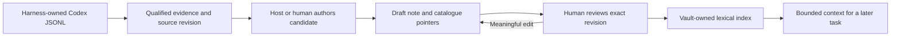

# Knowledge lifecycle usage

Vau-M now supports a bounded learning loop: **native Codex evidence → authored draft → human review → fresh task briefing**. The Engine does not call a model to invent a summary. A host agent or person supplies claims and exact supporting excerpts; review makes one saved revision eligible for normal retrieval.

The [PRD](prd-knowledge-lifecycle-correctness.md) defines the scope. The [implementation evidence](../vault/01_Journal/Reviews/2026-11-15%20-%20Knowledge%20Lifecycle%20Implementation%20Evidence.md) records what was exercised and what still needs acceptance.



## 1. Select the vault and source

Run from the repository root with its interpreter. Use absolute paths for an external vault. Provider overrides select existing stores; transcripts remain owned by their harness.

```powershell
$env:VAULT_PATH = 'D:\path\to\selected-vault'
$env:CODEX_SESSIONS_PATH = "$env:USERPROFILE\.codex\sessions"
.\backend\venv\Scripts\python.exe backend\vault_manager.py validate
.\backend\venv\Scripts\python.exe backend\vault_manager.py catalogue-sessions --provider codex --limit 50
```

Catalogue limits count newly created notes, so repeating a limited scan progresses through later sessions. Existing references are matched conservatively; ambiguous legacy identity is an error. Partial scans report the unavailable provider individually.

Repeat scans refresh owned source fields (provider/session identity, source path/scope/hash, parse state, workspace/repository, model/times, message count and size) and report them in `updated`. These updates do not consume the new-note limit. Human body text, comments, topic and custom metadata remain intact; the original body is a catalogue snapshot, while frontmatter carries current source facts. Anchored/aliased owned values that cannot be changed independently require explicit editing.

| Source | Browse/catalogue | Knowledge and complete evidence export |
| --- | --- | --- |
| Native Codex JSONL | Supported native envelope, actual evidence counts and parse diagnostics | Qualified supported text/tool events only; source must be complete |
| Claude, Cursor, Gemini, Kilo Code, Copilot | Existing readers retained; unqualified | Refused pending separate native-format qualification |

The Codex reader recognises wrapped `response_item` text, tool calls/results and mirrored events. Physical `L<number>` locators refer to the exact source hash. It distinguishes `complete`, `partial`, `unsupported`, `empty` and `unreadable`. Compaction, unknown content, malformed JSON, unpaired tools or detected source changes prevent complete publication. Known metadata is counted separately. Local 0.166.0 shapes were inspected; this is not universal version support.

Source identity combines provider, canonical store and native session ID. Workspace comes from source metadata. Repository scope is a verified Git root found from that workspace; unavailable/unrecognised roots remain unknown rather than being inferred from a transcript folder name.

## 2. Prepare and submit a candidate

Read evidence through the Sessions page, MCP `vault_session_prepare`, or CLI:

```powershell
.\backend\venv\Scripts\python.exe backend\vault_manager.py prepare-session codex '<native-session-id>' --source-key '<source-key>' --offset 0 --limit 30
```

Follow `next_offset` to read further pages (maximum 100 items per page). Do not combine pages from different `source_revision` values. Page limits limit items, not the contents of each evidence item.

Write `candidate.json` with the source key/hash returned above. Section names come from the selected vault's template: discover them through `GET /api/lifecycle/capabilities` or MCP `vault_capabilities`. This abbreviated **synthetic example** is a shape illustration, not a submit-ready candidate:

```json
{
  "schema_version": 1,
  "source_key": "<source-key>",
  "source_revision": "<sha256-of-source-bytes>",
  "title": "SQL alias correction",
  "kind": "troubleshooting",
  "sections": {
    "Fix": [{
      "text": "Replace sub.distance with v.distance.",
      "state": "proposal",
      "evidence": [{"id": "L6", "quote": "Replace undefined sub.distance with v.distance"}]
    }]
  }
}
```

Allowed kinds are `synthesis`, `troubleshooting`, `adr`. Allowed claim states are `proposal`, `observation`, `verified_result`, `accepted_decision`, `unknown`. Each supplied claim requires an exact, non-empty source excerpt of at most 600 characters. `accepted_decision` requires user evidence; `verified_result` requires tool-result evidence. These structural checks cannot establish whether a claim faithfully interprets its evidence; human review remains necessary. Empty sections explicitly say no supported claim was supplied.

```powershell
.\backend\venv\Scripts\python.exe backend\vault_manager.py distill-session codex '<native-session-id>' --source-key '<source-key>' --candidate .\candidate.json --target-dir 25_Knowledge_Base
```

Without `--candidate`, the compatibility command creates an unknown-only draft; it does not claim to have distilled useful knowledge. Such an empty draft cannot be reviewed into eligibility.

The artifact identity is source plus kind, independent of its title. An exact repeat is unchanged. Different content or an intervening human edit requires the current `--expected-revision`; an explicit replacement returns to draft. Never copy an old revision into an update command without reading the current note.

## 3. Human review

In Sessions, select a complete Codex session, choose the draft action, select the layout-provided destination and template, and add claims with evidence. Save the draft, read its saved preview, enter the reviewer name and confirm the evidence before approving that revision. The same panel can revoke review. Evidence is paged and tool text can be expanded completely.

For an existing draft, obtain the current preview through the shared JSON boundary:

```powershell
'{"path":"25_Knowledge_Base/<artifact>.md"}' | .\backend\venv\Scripts\python.exe backend\lifecycle_service.py preview
```

After a person has reviewed that exact preview:

```powershell
.\backend\venv\Scripts\python.exe backend\vault_manager.py review-note '25_Knowledge_Base/<artifact>.md' --expected-revision '<preview-revision>' --reviewer 'Gregory Mifsud' --confirmed
```

Use `--revoke` with the same confirmation process to remove eligibility. Review is deliberately absent from MCP tools. A meaningful edit invalidates the reviewed revision. Historic `status: verified` or `type: decision` alone never grants trust; legacy notes remain readable and diagnostic-only until individually converted and reviewed. This is a local workflow assertion, not an authenticated multi-user approval service.

## 4. Retrieve context

```powershell
.\backend\venv\Scripts\python.exe backend\query.py search 'SQL alias correction' --repo '<canonical-repository-scope>'
.\backend\venv\Scripts\python.exe backend\query.py brief 'SQL alias correction' --repo '<canonical-repository-scope>' --max-chars 12000
```

Copy the canonical repository scope from source/note metadata. Filtering is exact; unknown scope and other repositories are excluded. Default retrieval includes only current reviewed revisions. `--include-unreviewed` is explicit diagnostic inclusion and labels draft/stale/legacy results. `--include-memory` adds unreviewed global focus explicitly; `--neighbours` adds at most two eligible, unambiguous linked notes under the same filters.

The default briefing includes at most five primary notes and 12,000 characters, including provenance. Index chunks are at most 4,000 characters; preambles and code fences retain their content. Oversized briefing blocks are omitted with an explicit marker. Provenance distinguishes an available source revision from changed or unavailable sources with retained historical excerpts. No match means no asserted answer.

`query.py embed` now refreshes the local FTS5 lexical index. There is no model download or qualified vector-search path in this increment. The cache lives under ignored `backend/runtime-cache/<canonical-vault-hash>/knowledge-v2.db`, carries owner/schema information, and refreshes on the next completed query after content changes. Refresh failures return errors instead of stale results. The old shared database is untouched.

## 5. Adapters and generated configuration

| Entry | Shared operation |
| --- | --- |
| CLI `prepare-session`, `distill-session`, `review-note` | Preparation, publication and explicit human review |
| `POST /api/sessions/distill` | Draft publication with source key, candidate and optional expected revision |
| `GET /api/lifecycle/capabilities` | Selected layout targets, template sections, provider qualifications |
| `POST /api/lifecycle/{prepare,submit,preview,review,export,search,brief}` | JSON arguments passed to the Engine |
| MCP `vault_session_prepare`, `vault_distill_session`, `vault_search`, `vault_brief` | Same evidence, write and retrieval contracts; no review tool |
| MCP `vault_export_session`, `vault_catalogue_sessions`, `vault_capabilities`, `vault_may_write` | Qualified export, pointers and policy inspection |

HTTP uses the repository interpreter and passes JSON over stdin, without a shell. Unparseable Engine stdout is an error; conflicts retain HTTP 409, policy denials 403, partial publication 207. Review requires `human_confirmed: true`. The CLI JSON service emits `{ok,result}` or `{ok:false,error,code}`; callers must inspect `ok`.

`architect_generator.py` writes `vau-m-engine` in the generated `claude.json` with an absolute interpreter, absolute MCP script and absolute target `VAULT_PATH`. Register that entry using the chosen client's format; the presence of the file alone does not register it. The local pilot used the actual installed Codex app-server client with invocation-only configuration and no model turn. No global harness configuration was changed. If the Engine checkout/interpreter moves, regenerate the binding.

The generated file still contains pre-existing third-party server entries; those integrations are outside this qualification. Only `vau-m-engine` was exercised.

## 6. Failure recovery and maintenance

| Outcome | Meaning and next action |
| --- | --- |
| `created` / `updated` / `unchanged` | Artifact and required references completed; review state is returned separately |
| Conflict | Preview current content, then decide whether to submit with its revision; no implicit overwrite |
| `partial` with `persisted` | Those listed files were saved. Repair the stated destination/policy issue and resubmit the same candidate |
| Partial followed by a human edit | Use `--repair-references` with the original candidate to preserve edited primary content while repairing catalogue/MOC references |
| Existing `.stage.tmp` | Inspect the interruption file; it is never silently deleted or overwritten |
| Policy changed during work | Reload layout and retry; the old policy snapshot cannot authorise a write |
| Incomplete/unqualified source | Browse diagnostics; do not label a shortened export as complete or submit it as qualified knowledge |

Every destination and staging path is preflighted and checked again at replacement. Engine writers are serialised per vault and use optimistic content revisions; this does not lock Obsidian or arbitrary editors. Publication is atomic per file, with explicit multi-file partial results.

`query.py compact` archives complete multiline ledger entries and verifies the archive before trimming MEMORY. Denied/failed archival leaves MEMORY unchanged. `heartbeat`, calendar and NotebookLM integration report skipped/unconfigured work honestly; they do not claim remote sync or notifications happened.

The static dashboard fallback bundles Markdown from the vault selected **at build time**. Build with a sanitised vault before sharing a bundle. A running API can select a different vault; rebuild for its intended fallback. Build products and runtime caches stay ignored.

## 7. Reproduce the synthetic pilot

```powershell
.\backend\venv\Scripts\python.exe -m pytest backend\tests -q
npm --prefix frontend test
npm --prefix frontend run lint
.\backend\venv\Scripts\python.exe backend\tests\pilot_smoke.py 'C:\path\to\codex.exe'
```

The smoke helper creates a disposable generated vault under `backend/runtime-cache`, supplies synthetic claims, records an explicitly automated fixture review, and calls its Engine through the real client. It never substitutes for human acceptance. Inspect `pilot.json` and `mcp-evidence.json` in the printed directory. No dependency installation or cloud/model call is needed.
