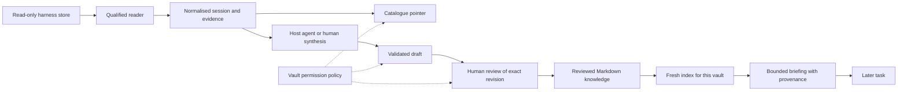

# PRD: Knowledge Lifecycle Correctness

**Proposed outcome:** a native Codex session can become an evidence-linked, reviewed knowledge note that a later task retrieves from the correct vault, without losing source meaning, overwriting edits or requiring manual index deletion.

**Approval state:** Gregory approved v0.1 on 2026-11-15 with “go ahead”. Execution covers milestones M1–M5 below. Qualification of the other five harnesses is a follow-on increment, not a condition hidden inside this pilot and not a claim made by its completion.

**Implementation state:** M1–M4 correctness gates pass; M5 adapters, HTTP integration and actual Codex MCP-client proof pass. Full visual draft/review acceptance and AC-20 human usefulness confirmation remain pending. See the [implementation evidence](../vault/01_Journal/Reviews/2026-11-15%20-%20Knowledge%20Lifecycle%20Implementation%20Evidence.md) and [usage guide](knowledge-lifecycle-usage.md). The baseline defects described below are retained as the rationale, not asserted as the current implementation.

## 1. Problem and success criteria

The original objective is to store and organise agentic/LLM conversation outputs, massage them into useful knowledge, and use that knowledge for future tasks. The current implementation provides much of the structure, but its successful tests do not establish that outcome: native messages can be discarded, unsuccessful fixes can be labelled verified, notes can overwrite one another, and retrieval can be stale or belong to another vault.

The corrective release succeeds when:

1. One qualified native source passes the complete workflow, including user messages, assistant messages and tool evidence.
2. Failed attempts, proposals, accepted decisions, observed results and open tasks remain distinguishable in the saved note.
3. Every reusable assertion has a source reference; no generated text automatically becomes verified or accepted.
4. Repetition, conflicting writes, denied paths and interrupted operations preserve existing authored content and report their actual outcome.
5. A later task retrieves the reviewed result with provenance and current content, within a bounded context size, from the selected vault only.
6. The acceptance cases in section 8 pass, and the live pilot demonstration is recorded separately from automated test results.

Passing a test count, producing Markdown headings or exposing an MCP tool is not sufficient release evidence.

## 2. Evidence and existing constraints

The source assessment is [Knowledge Lifecycle Objective Review](../vault/01_Journal/Reviews/2026-11-15%20-%20Knowledge%20Lifecycle%20Objective%20Review.md), findings F1–F11. The original request is at lines 3–4 of [the implementation transcript](determine%20objective%20for%20agentic%20vault.md). The [previous implementation plan](implementation-plan-knowledge-lifecycle.md) remains historical context; this corrective PRD governs the next increment once approved.

| Current path inspected | Relevant source facts |
| --- | --- |
| [session_providers.py](../backend/session_providers.py): `default_provider_paths`, `_parse_codex_entry`, `discover_cursor_sessions` | Windows replacement handling, native envelope handling and session identity need correction (lines 76–104, 204–255, 310–351). |
| [session_distiller.py](../backend/session_distiller.py): builders and `distill_transcript_to_vault` | Status assertions, title-based filenames, secondary writes and publication ordering are unsafe (lines 44–155, 159–256). |
| [session_catalogue.py](../backend/session_catalogue.py): `catalogue_records`, `_index` | Deduplication exists, but actual destination checks and catalogue update semantics are incomplete (lines 44–71, 230–243). |
| [query.py](../backend/query.py): `compact_memory_file`, `search`, `brief` | Archival failure can lose data; the index path is global and freshness depends on file existence (lines 71, 165–242, 381–438). |
| [knowledge_index.py](../backend/knowledge_index.py): chunking, search and briefing | Preamble loss, incomplete metadata and unbounded context; lexical retrieval is already available. |
| [mcp_server.py](../backend/mcp_server.py), [architect_generator.py](../backend/architect_generator.py) | Tools share a database; generated launch configuration lacks an explicit target-vault binding. |
| [server.js](../frontend/server.js), [sessions.js](../frontend/sessions.js), [SessionsPage.tsx](../frontend/src/pages/SessionsPage.tsx) | UI → HTTP → Python distillation exists; browsing/export still use separate readers. |

Baseline: `main`, `c8c34c9`, including the uncommitted implementation reviewed on 15 November 2026. That review recorded 87 passing Python tests, 17 passing frontend tests, TypeScript and vault validation, plus independent reproductions of defects. Those results are prior review evidence, not validation of this proposed implementation.

Preserve the existing Python Engine, SQLite, Markdown/Obsidian and Express/React Control Panel. [vault.config.yaml](../vault/vault.config.yaml) remains authoritative for layout and permissions. Zone and write permission remain separate. Harness stores own transcripts; catalogue notes are pointers. Use the repository Python environment and Windows-native execution. No WSL crossing is required.

## 3. Scope and proposed decisions

| Decision | Proposed default and reason |
| --- | --- |
| First qualified source | Native Codex rollout records. A real-format failure was reproduced and a local source is available for qualification. |
| Other sources | Retain browsing where available, labelled unqualified. Disable knowledge-producing actions/export claims for a format until its native fixtures pass. No silent fallback to a different parser. |
| Synthesis | The current host agent or a human supplies an evidence-linked candidate. The Engine validates and persists it. Heuristics may prepare an explicitly incomplete draft, never an authoritative conclusion. |
| Review | A human explicitly reviews a content revision before it enters default future-task retrieval. Review of fidelity is distinct from proof that a technical claim is true. |
| Retrieval | FTS5 is the pilot baseline. Freshness, vault identity and provenance apply to every retrieval path, including any retained optional vector path. No new model download is needed. |
| Raw retention | Keep transcripts in their source store. Store bounded supporting excerpts and source locators with notes; report missing/changed sources honestly. Independent archival/recovery is deferred. |
| Existing notes | Preserve bodies, names and MOC links. Missing lifecycle metadata means legacy/unreviewed, never implicitly trusted. Explicit diagnostic search can include these notes. |
| API and UI | Keep existing entry points where practical; make outcomes explicit. “Create note” becomes a draft-producing action; a successful draft is not a reviewed result. |

In scope: all shared safety defects F3–F9; Codex qualification and explicit capability reporting for F1; trustworthy draft/review flow for F2; bounded, scoped retrieval for F10; truthful evidence/status reporting for F11.

Out of scope: qualifying all remaining source formats in this increment; web-chat export formats and attachments; autonomous scheduling; external sync/notification implementation; an embedded LLM provider; a graph database or vector service; a universal ingestion framework; multi-user hosting or security certification. Existing maintenance stubs must say skipped/not implemented instead of claiming success.

## 4. Tourist map



The Engine owns normalisation, validation, permission checks, publication and indexing. The host agent owns candidate synthesis; the human owns review. UI and MCP adapt the same Engine operations rather than redefining these rules. Markdown remains the authored source of truth; SQLite is a rebuildable cache.

## 5. User workflow

1. Gregory selects a Codex session and sees its topic, repository, source and whether parsing is complete.
2. The Engine makes the ordered conversation and evidence references available to the host agent. Long sessions are paged without silently dropping turns.
3. The agent proposes a draft that separates the failed approach, the supported result, decisions and remaining work. Each claim links to supporting evidence; missing information stays unknown.
4. Gregory previews the draft and its destination. Saving creates a draft without replacing existing knowledge.
5. Gregory reviews or edits it and explicitly approves the displayed revision. Technical verification or ADR acceptance must have its own supporting evidence.
6. In a later task, an agent requests context for the same repository. The briefing includes the reviewed result and references, but excludes another vault's knowledge and unreviewed drafts by default.
7. Editing the note invalidates review of the old revision until reviewed again. Retrieval reflects edits, deletions and review changes on the next completed request.

The pilot may use the CLI and normal Markdown editing for review; it does not require a rich-text editor or an autonomous agent runner.

## 6. Minimal data and state contract

These are required semantics, not a mandate for a class per row or a new framework. Establish one versioned Python contract before changing UI payloads. Share it through structured Engine responses.

| Record | Required semantics |
| --- | --- |
| Vault identity | Canonical resolved root using the existing resolver; platform-appropriate path normalisation. Cache ownership includes this identity and a schema version. A changed root is a different cache; no vault manifest migration is required. |
| Source session | Provider, source-store scope, native session ID, source locator, source fingerprint, actual message count, parse outcome, available repository/workspace metadata. Never use a title, date folder or whole Cursor workspace as conversation identity. |
| Evidence item | Stable reference within a fingerprinted source revision; ordered role/kind, full text, timestamp when available, and native event/line/block locator. Tool calls and results preserve their relationship where provided. Unknown values are explicit. |
| Candidate note | Schema version, source session/revision, note kind, destination, title, proposed sections and evidence references per claim. Submission cannot set review approval. |
| Saved artifact | Stable artifact identity independent of title; source/revision, repository scope, note kind, draft/review state, content revision/hash, provenance and validation outcome. For the pilot, one artifact per source session and note kind is sufficient. |
| Review record | Reviewer, UTC timestamp and hash of the meaningful note content reviewed. The hash excludes review bookkeeping itself. A content mismatch makes the current revision unreviewed. |
| Publication result | Actual outcome: completed, unchanged, conflict, denied, invalid, or partial/failed with affected paths and a recovery instruction. It also reports index freshness. |

Repository scope is derived from source metadata. If a repository root cannot be established, retain the recorded workspace and mark repository unknown; never guess from a date or directory label. Exact `repo` filtering must not include unknown or merely similarly named repositories. Cross-worktree grouping is deferred until there is a real requirement.

Separate three concepts:

- **Parse outcome:** complete, partial, unsupported, empty or unreadable. Recognised non-conversation events can be ignored with counts; malformed or unknown content-bearing records cannot silently disappear. Only complete supported inputs enter the pilot distillation flow.
- **Review state:** draft → reviewed by an explicit human action. Later meaningful edits invalidate the prior review. Previous legacy `status: verified/accepted` fields do not establish a valid review record.
- **Claim evidence:** proposal, observation, verified result, accepted decision or unknown. A verified result needs a cited verification outcome; an accepted decision needs a cited human decision. Reviewing an accurate note about a failed experiment does not turn the experiment into a success.

Source fingerprints are checked when preparing/submitting a candidate. Changed input requires re-preparation or an explicit new draft revision. If the raw source later disappears, preserve the saved knowledge and supporting excerpts, label live source verification unavailable, and never claim that source retention was guaranteed.

## 7. Functional requirements

### FR-01 — Qualified, non-lossy input (F1, F8)

Read Codex's native envelope and metadata structure, user/assistant turns, tool calls/results and text blocks. Prefer the canonical message stream so duplicate event/response representations do not duplicate conversation turns. Preserve ordering and source locators; do not truncate extraction content to UI display limits. Decode failures, incomplete trailing records and unsupported variants produce explicit outcomes.

Test native Windows paths, placeholders and spaces. Resolve only the requested source configuration where possible; one unavailable provider must not masquerade as an empty successful scan of all sources. Repeated discovery must retain stable identities. Catalogue limits must permit progress beyond already-catalogued recent sessions.

### FR-02 — Identity and safe repeat operations (F1, F3)

Deduplicate catalogue entries by source identity, and update machine-owned metadata for changed sessions without replacing human content. Two sessions with the same title must remain distinct. Artifact lookup uses identity rather than a regenerated filename. Exact repeat submissions return unchanged; a different proposal or changed on-disk content returns a conflict with a preview. An explicit replacement uses the expected revision and returns the artifact to draft; no silent overwrite.

### FR-03 — Complete write-policy enforcement (F4)

Resolve and preflight every actual destination before the first mutation: note, catalogue, MOC, archive and any temporary publication file. Recheck destinations before replacement. Respect unmanaged/hidden paths, traversal, resolved links and more-specific overrides. A denied destination leaves all authored files unchanged.

Backup/export into a managed vault is subject to the same policy, including every final provider subdirectory/file. An explicitly selected external export remains a separate operation and cannot bypass source/target validation. Export complete normalised messages for qualified formats; report unsupported or partial formats rather than use the old truncating renderer. The API must use the selected vault identity explicitly.

### FR-04 — Recoverable publication (F3, F4)

Use atomic replacement per file and serialise conflicting Engine writes within a vault; detect competing human edits using expected content hashes. Do not claim a transaction across multiple Markdown files. Persist the artifact first, update derived MOC/catalogue references next, and record successful completion last. An interruption after artifact persistence returns a partial result; a retry detects the same artifact and repairs missing derived references without duplicate content or lost edits. Denials discovered during preflight cause no writes.

### FR-05 — Non-destructive ledger compaction (F7)

Treat a rolling-log entry as a complete block, including continuation paragraphs, nested bullets and fenced code. Persist and verify the archive before trimming MEMORY. If permission, write or verification fails, retain the original MEMORY unchanged and return failure. Deduplicate exact entries, not substrings. Repeating a successful compaction is a no-op and reports only entries actually archived.

### FR-06 — Evidence-linked draft and explicit review (F2)

Provide a read-only preparation operation that yields session metadata plus paged evidence. Accept a versioned candidate from the host agent or human, validate source references and allowed section/state values, and render through the existing templates as the single formatting source. The Engine validates structural evidence links; it must not claim to prove semantic truth automatically.

Treat source conversations and retrieved text as evidence, not as instructions authorising tool execution or changes to vault policy. Preserve attribution when quoting a historical instruction or decision.

Preserve synthesis, troubleshooting and ADR note kinds. All generated artifacts start as drafts. Unknown sections remain explicitly unknown. Files merely mentioned are labelled referenced, not changed. A successful creation response includes draft state. Reviewing is an explicit user action against the current artifact revision; an MCP synthesis tool cannot approve its own output. A reviewer may record unsupported statements as proposals/unknowns instead of inventing evidence.

### FR-07 — Vault-scoped, fresh retrieval (F5, F6)

Bind each cache to the canonical vault identity and schema. Refuse a mismatched cache. Refresh changed and deleted Markdown entries before returning results; an existing DB file is not proof of freshness. Compare content fingerprints so timestamp-only assumptions cannot miss changes. Publish each refreshed index generation in a SQLite transaction.

Use a simple on-demand refresh for the local pilot; no watcher or queue is required. Coordinate Engine write/retrieval operations so a completed write is visible to the next query. Detect files changing during collection and retry a bounded number of times or return an explicit refresh failure. Do not return a stale success after refresh failure. Cache rebuilds never change Markdown. The old shared database is ignored rather than automatically deleted.

### FR-08 — Useful, bounded context (F10)

Preserve preamble and section text, avoiding false headings inside fenced code. Split oversized sections deterministically while retaining evidence and heading locators. Proposed named defaults: 4,000 characters per content chunk, five primary hits, and 12,000 characters for the entire briefing including metadata. These are character budgets, not an exact model-token guarantee; caller limits are validated and omission is explicit.

Carry vault/repository scope, review state, note/source revision and provenance into search and briefing results. Default future-task briefings include only currently reviewed knowledge. An explicit diagnostic option can include legacy notes/drafts, labelled by state. Raw catalogue pointers and operational ledgers are not presented as reviewed knowledge. Global MEMORY focus is opt-in and separately labelled, especially for repository-scoped tasks.

Select/rank lexical candidates in SQLite before loading full bodies, use a stable secondary ordering for ties, and do not duplicate a whole note across many primary hits. Optional one-hop expansion resolves at most two readable, in-vault neighbours under the same repository/review rules and total size budget. Unresolved/ambiguous links remain labelled pointers. Return valid structured output when nothing matches or a budget is too small; never cut JSON, source identities or metadata midway.

### FR-09 — Consistent interfaces and vault binding (F1, F9)

Keep CLI, HTTP and MCP adapters thin. Establish Engine operations for preparation, candidate submission, explicit human review, catalogue/export and retrieval before adding controls. Preserve existing useful entry points; document intentional changes to draft semantics and error responses. A malformed Python response is an API error, not fallback success containing stdout.

The qualified Codex UI browse/export/distillation paths consume the same normalised contract; do not maintain independent semantics in JavaScript. Other browsing readers may remain unqualified pending their own increment. UI choices come from the selected layout/capabilities rather than hardcoded writable folders. Surface incomplete parsing, conflicts, partial publication and review state plainly.

Generated MCP configuration binds an explicit repository interpreter, script and absolute `VAULT_PATH`; client working directory and ambient PATH must not change the target. Validate protocol/registration details against the actual selected client during M5. Supply configuration for review and exercise an isolated client configuration; do not silently change global harness settings. Pilot operation remains local; network deployment and cross-platform certification are outside this PRD.

### FR-10 — Honest validation and capability reporting (F11)

Validate required lifecycle fields and evidence/review consistency for the new schema. Existing unrelated note types remain readable without bulk rewriting. Diagnostics distinguish missing metadata from malformed YAML. Report provider capability per qualified format, incomplete scans, unimplemented maintenance actions, cache freshness and partial writes. Never claim all sources or all phases complete from tests of one fixture.

Record acceptance evidence in Dataview-compatible vault notes with revision, commands, fixture identifiers, outcomes and unrun checks. Documentation must show how another task requests a briefing and how a session contributes a draft. No background processing is claimed without a running, validated mechanism.

## 8. Acceptance cases

All cases are required for M5 pilot acceptance. Evidence must record actual outcomes rather than just test names. Synthetic fixtures supplement sanitised native-format examples; the latter record the producing harness/version where available without exposing private transcript content.

| ID | Scenario | Required result |
| --- | --- | --- |
| AC-01 | Native Codex history with wrapped turns, tools and duplicate event representations | Expected ordered conversation and tool evidence, one copy per logical event; correct session/workspace metadata and actual count. |
| AC-02 | Empty, malformed, unsupported, truncated or changing source | Explicit incomplete/error outcome; no knowledge note or false completion; recognised non-content events counted separately. |
| AC-03 | Windows source overrides and a batch with one unavailable provider | Literal/placeholder paths with spaces work; each source gets its own outcome; no regex escape error or blanket success. |
| AC-04 | Repeat catalogue scan; same-title distinct sessions; more than one batch | Stable identities, no duplicate pointers, no overwritten note; later sessions remain reachable. |
| AC-05 | Repeat candidate; human edit; two concurrent submissions | Exact repeat is unchanged; stale revision/conflicting content is refused; human text survives; no duplicate artifact. |
| AC-06 | Denied note, catalogue, MOC, archive, hidden path, override or escaping link | Every denied operation leaves authored files unchanged; the precise destination/reason is reported. |
| AC-07 | Export targeted under read-only Journal; export to a permitted selected destination | First denied; second preserves all supported text and evidence ordering, with no truncation represented as a full backup. |
| AC-08 | Failure before artifact write, then after it but before MOC/catalogue completion | No false complete state; partial result describes persisted paths; retry repairs references without rewriting human edits. |
| AC-09 | Memory entries with continuation text/code and a denied/failing archive | Entry bodies preserved; failed archive leaves MEMORY byte-for-byte unchanged; repeated compaction creates no duplicates. |
| AC-10 | Transcript contains failed attempt, correction, accepted result, open task and final conversational sign-off | Draft preserves those distinctions; sign-off does not replace the fix; every substantive claim has evidence; no automatic verified/accepted state. |
| AC-11 | Human review followed by a meaningful note edit; old legacy `verified` status | Exact reviewed revision eligible; edited revision becomes unreviewed; legacy status alone never grants eligibility. |
| AC-12 | Vault A/B with identical relative filenames and disjoint facts | A fact never appears in B; mismatched cache rejected; switching/rebuilding cannot replace the other vault's index. |
| AC-13 | Create, review, edit, unreview and delete a note after initial search | Next completed query reflects the change without DB deletion; failed refresh is explicit and never returns stale success. |
| AC-14 | Preamble, code-fence headings, oversized section, related/ambiguous links | Text remains searchable; chunks/brief obey budgets; links obey scope/review limits; no silent truncation or broken structured output. |
| AC-15 | Same terminology in two repositories plus unknown-scope drafts | Exact repo filter excludes other/unknown scope; default briefing excludes drafts/legacy; diagnostic mode labels them. |
| AC-16 | UI → HTTP → Engine, including malformed response and write conflict | Same source/identity semantics as CLI; clear draft/partial/error feedback; no success-on-unparseable-stdout fallback. |
| AC-17 | Generated MCP launch from an unrelated working directory and misleading ambient PATH | Explicit interpreter and target vault used; initialise/list/call succeed in the selected real client; no Blueprint writes. |
| AC-18 | Maintenance stubs, schema violations and an unqualified provider | Honest skipped/invalid/unqualified reporting; no fake synchronisation, notification or provider-readiness success. |
| AC-19 | Fixed evaluation set: three relevant later-task queries and two no-answer cases | Expected reviewed evidence appears within the top five for each relevant query; two deliberately absent topics yield no asserted answer. Store queries/expected sources before the run. |
| AC-20 | A later host-agent task uses the AC-10 result through retrieval | Agent cites the supported fix and its verification limits, recognises the failed alternative and remaining task; human confirms usefulness. |

AC-20 is a recorded human acceptance exercise, not a claim that arbitrary LLM output is deterministic. Given identical source, candidate, layout and injected clock values, Engine normalisation/identity/serialization must be reproducible. Given the same index and query, retrieval ordering must be stable.

Concrete AC-10 example, **synthetic fixture, not a claim about a real session**:

| Evidence | Expected draft interpretation |
| --- | --- |
| E1: user reports an SQL alias error; E2: retrying the same query fails | Problem and failed attempt, not a fix. |
| E3: assistant proposes replacing an undefined alias | Proposed correction with E3 cited. |
| E4: tool output shows the targeted regression passing | Verification limited to that regression; no claim that the full suite passed. |
| E5: user accepts the correction and leaves a wider query audit open | Accepted decision and separate follow-up, both citing E5. |
| E6: assistant says “Thanks, done.” | Conversational closure; never the Root Cause or Fix. |

Record indexing and briefing duration, corpus/chunk count and returned characters for the pilot. This increment sets a correctness and bounded-context gate, not an invented production throughput target.

## 9. Data-first implementation sequence

All milestones start pending. After PRD approval, proceed through M1–M5 without repeated approval of routine implementation choices. A failed gate prevents claiming the next milestone complete; changes to agreed scope or destructive actions still need the relevant user decision.

| Milestone | Work and primary ownership | Exit evidence |
| --- | --- | --- |
| M1 — Identity and safe persistence | Define versioned data/outcome contract; surgical write preflight, collision/conflict handling, publication recovery and compaction. Primary files: `vault_layout.py`, `session_catalogue.py`, `session_distiller.py`, `query.py`. Small focused helpers only where needed to share policy. | AC-05, AC-06, AC-08, AC-09 regressions pass on disposable vaults; contracts documented. |
| M2 — Qualified Codex ingestion | Correct native parsing, evidence locators, source identity and Windows configuration in `session_providers.py`; catalogue progress/capability outcomes in `vault_manager.py` and `mcp_server.py`. Add sanitised fixtures under `backend/tests/fixtures/`. | AC-01–AC-04 pass; full transcript readback is qualified; other providers explicitly unqualified. |
| M3 — Draft and review lifecycle | Implement preparation/submission/review operations over the shared contract, source revision checks and templates. Primary files: `session_distiller.py`, `vault_manager.py`, `80_Templates/`, focused Engine tests. | AC-10, AC-11, lifecycle parts of AC-18 pass; one reviewed artifact has traceable evidence. |
| M4 — Fresh and scoped context | Vault-owned cache, fingerprint refresh, complete bounded chunking, repository/review filtering and briefing in `knowledge_index.py`, `query.py`, `mcp_server.py`. | AC-12–AC-15 and AC-19 pass; write → next-query visibility demonstrated. |
| M5 — Thin adapters and pilot proof | Codex UI reader/export bridge, draft feedback and review access, HTTP errors, explicit MCP binding. Primary files: `frontend/sessions.js`, `frontend/server.js`, `frontend/src/lib/vault.ts`, `frontend/src/pages/SessionsPage.tsx`, `architect_generator.py`; update usage docs/ledger. | AC-07, AC-16–AC-18, AC-20; all acceptance cases reconciled; actual UI and one real MCP client exercised. |

Use meaningful regression tests for the recorded failure scenarios before changing their implementation. Work on isolated fixture vaults until the final pilot. New helper files are implementation choices within these responsibilities; do not introduce a generic orchestration platform or parallel-agent workflow.

The subsequent provider increment qualifies Claude, Cursor, Gemini, Kilo Code and Copilot against real-format samples, including distinct Cursor conversations and full Gemini text recovery. It uses the same contracts and acceptance gates rather than duplicating pipelines. Missing native fixtures block a qualification claim, not unrelated shared remediation.

## 10. Compatibility, failure recovery and validation

Preserve the current dirty working tree and recheck it before execution. Do not commit, push or merge as a side effect of this PRD. Existing CLI names should remain where compatible; document the intentional changes from implicit overwrite/verified output to conflict/draft semantics.

No automatic renaming, wholesale metadata conversion or raw transcript migration. Legacy notes/catalogues remain readable; match existing entries conservatively, and report ambiguous identity instead of guessing. New-schema writes can add machine-owned metadata when the expected existing revision matches. Reviewed content is never inferred from historic labels. The old shared cache is left untouched and can be removed later by an explicit operator action; no automated recursive cleanup is required.

If a new capability is rolled back, disable its write/retrieval entry point and retain generated drafts/notes for inspection. Do not restore the unsafe shared cache or silently restore automatic verified-status behaviour. Failure evidence must distinguish no mutation from partial persistence.

Baseline verification commands, run from the repository root after implementation:

```powershell
.\backend\venv\Scripts\python.exe -m pytest backend\tests -q
.\backend\venv\Scripts\python.exe backend\vault_manager.py validate
npm --prefix frontend test
npm --prefix frontend run lint
git diff --check
```

A frontend build check is also required for M5, using a sanitised fixture vault or verified safe bundling configuration: the current static fallback can bundle local Markdown, so do not distribute a build containing private source data. Build output stays uncommitted. Document sandbox workarounds separately from product failures. No dependency installation, cloud provider call or model download is needed merely to validate this PRD.

Use one actual available MCP client in an isolated configuration for AC-17; Codex is the proposed first choice. Confirm its current registration/protocol contract during M5 instead of assuming that writing `claude.json` proves integration. If an actual client cannot be exercised, keep that gate pending and report CLI/API results separately.

For each milestone, record revision, cases passed/failed/unrun, fixture version, relevant logs and remaining limits in the vault. Passing tests from the earlier review are not substitutes for rerunning the changed paths. Do not repeatedly run the whole suite without new changes or unresolved failures.

## 11. Risks and bounded decisions

| Risk or uncertainty | Treatment |
| --- | --- |
| Native source formats change | Versioned sanitised fixtures and explicit unsupported outcomes; no universal compatibility claim. |
| Evidence references exist but a summary misrepresents them | Human review plus the failed-attempt/accepted-outcome fixture; structural validation alone cannot certify fidelity. |
| Review adds friction | Review one exact artifact revision; reuse it across future tasks. No heavyweight approval service. |
| Full fingerprint scanning becomes slow | Measure local corpus behaviour. Optimise only after evidence; preserve freshness and isolation while doing so. |
| Source removal makes live evidence unavailable | Retain reviewed note and bounded cited excerpts with provenance status; separate retention work if required. |
| Legacy notes become excluded from default briefings | Explicit diagnostic inclusion and gradual individual review; no bulk trust upgrade. |
| Concurrent human editing | Revision checks and explicit conflicts; serialisation only for Engine writers. No claim to lock Obsidian or arbitrary editors. |

No unresolved product decision prevents drafting this PRD. Initial source, synthesis ownership, review semantics and narrowed release scope are proposals for sign-off. Unknown provider variants and client details remain bounded qualification tasks rather than assumptions of support.

## 12. Approval and completion record

| Item | State |
| --- | --- |
| PRD owner/reviewer | Gregory Mifsud |
| Proposed baseline | Version 0.1; Codex pilot plus shared correctness |
| Explicit approval | Gregory, 2026-11-15 |
| Execution | Implemented; final acceptance pending |
| M1–M4 gates | Automated correctness evidence passed |
| M5 gates | HTTP and actual MCP-client passed; visual form and human usefulness pending |
| Approved milestones | M1–M5 |
| Follow-on scope | Remaining five provider qualifications, independent raw retention, additional chat formats |

Sign-off means accepting the proposed defaults and authorising M1–M5 under the repository safeguards. It does not authorise destructive migration, global harness reconfiguration, publishing or deployment. Mark this PRD implemented only after every required acceptance case has evidence and remaining provider limitations are visible in the product and documentation.
