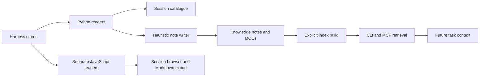

# Knowledge Lifecycle Objective Review

**Verdict: partially satisfied, with material correctness gaps.** The implementation supplies a useful vault structure, catalogue, note-generation path, lexical search and retrieval interfaces. It does not yet reliably turn supported harness histories into trustworthy knowledge that future tasks can retrieve. The transcript's statement that all phases are complete and verified is too strong.

Advisory review using `software-architect:architecture-router`, routed to `architecture-review`. No execution code was changed; existing uncommitted implementation work was preserved.

## Scope and requirement coverage

The requirement is the original request at lines 3–4 of [the implementation transcript](../../../docs/determine%20objective%20for%20agentic%20vault.md): store and organise agentic/LLM chat outputs, massage them, and use the resulting knowledge to assist future tasks. The [implementation plan](../../../docs/implementation-plan-knowledge-lifecycle.md) supports that objective; satisfying its narrow tests is not equivalent to satisfying the objective.

Reviewed `main` at `c8c34c9`, including dirty tracked files and untracked provider, distiller and MCP modules present on 15 November 2026. Findings describe that working tree, not just the committed revision. The separate architect workspace was not assessed.

Assumption: a local personal system, initially using the six named harness sources. Preserve the established decision that harness stores own raw transcripts and `35_Sessions/` holds catalogue notes. Absence of a second transcript copy is not itself a defect.

| Requirement | Current capability | Assessment |
| --- | --- | --- |
| Locate and catalogue outputs | Six Python readers, metadata/pointer notes, session deduplication | Partial: actual Codex envelopes discarded; Cursor conversations merged; Windows overrides fail |
| Store results safely | Markdown notes, source-session IDs, MOCs, separate export | Partial: collisions overwrite content; secondary writes bypass policy |
| Organise knowledge | Layout-driven folders, templates, MOCs, YAML syntax validation | Useful foundation; no enforced knowledge metadata/review-state contract |
| Massage transcripts | First user/final assistant turns placed in three note shapes | Insufficient: proposals, failed attempts, verified fixes and accepted decisions are not distinguished |
| Retrieve for future tasks | FTS5 chunks, optional embeddings, briefing command, MCP tools | Partial: shared/stale index; missing context, repository/review filters and size budget |
| Repeat the complete loop | Individual CLI/UI/MCP operations | No qualified capture → reviewed knowledge → fresh retrieval → useful later task acceptance result |

## Actual flow

UI distillation: `SessionsPage.handleDistill` → `vault.ts.distillSession` → `POST /api/sessions/distill` → `vault_manager.distill_session` → discovery/read → `distill_transcript_to_vault`. Browsing/export retain independent JavaScript readers. Note creation does not refresh the retrieval index.

## Findings

### F1 — High: ingestion is not qualified against real harness records

**Location:** [session_providers.py](../../../backend/session_providers.py), `_parse_codex_entry` lines 204–218, discovery lines 237–250; Cursor reader/discovery lines 277–348. [test_session_providers.py](../../../backend/tests/test_session_providers.py) supplies flat Codex `role/content` fixtures.

**Issue:** Codex parsing reads only top-level role/type/content. Actual local records wrapped in `response_item.payload` are discarded. Discovery nevertheless reports at least one message, and distillation accepts an empty transcript. Codex project identity is the date directory rather than repository metadata. Cursor concatenates chats into one workspace-level session.

**Impact:** supported sources silently yield empty or incorrectly combined knowledge; repository filtering is unreliable.

**Remediation:** qualify each claimed source with sanitised native fixtures; normalise messages, tool results, session IDs and repository metadata. Explicitly report unsupported/empty input. Keep browsing/export and distillation on the same tested contract.

**Verification:** a local Codex sample had 3 wrapped user/assistant messages and 0 parsed messages. A synthetic Cursor SQLite fixture containing 2 chats produced 1 session containing both. Other native variants remain unqualified; this is not a claim that every historical format fails.

### F2 — High: distillation assigns truth without evidence

**Location:** [session_distiller.py](../../../backend/session_distiller.py), lines 52–81, 94–116, 130–155; [test_session_distiller.py](../../../backend/tests/test_session_distiller.py), lines 92–106.

**Issue:** troubleshooting copies the last assistant message into both Root Cause and Fix and sets `status: verified`. ADR output sets `accepted` without detecting approval. Synthesis copies two assistant turns, labels referenced paths as changed artifacts and supplies placeholder follow-ups. The writer does not read the added template files. The plan's optional `--use-llm` mode at lines 511–514 is absent; adding an LLM alone would not establish correctness.

**Impact:** unsuccessful experiments and unapproved proposals become authoritative-looking context.

**Remediation:** create drafts with source-message references and explicit unknowns. Separate proposals, observations, accepted decisions and open tasks; promote state only with evidence/review. An existing host agent can produce the structured draft without a new embedded model service.

**Verification:** a transcript ending “Candidate fix failed; root cause is still unknown.” generated a verified troubleshooting note with that sentence under both Root Cause and Fix. Existing tests assert structure, not semantic correctness.

### F3 — High: writes overwrite knowledge and mark completion prematurely

**Location:** [session_distiller.py](../../../backend/session_distiller.py), lines 193–200 and 215–246.

**Issue:** filename identity is kind/title only; `write_text` replaces existing content. The catalogue is marked distilled before the output note is written.

**Impact:** two sessions with one topic overwrite each other; reruns erase human corrections. A failed note write leaves a false completion state and dangling link.

**Remediation:** stable source/artifact identity, conflict detection, protection for reviewed edits, and a recoverable publication sequence that marks completion only after successful persistence.

**Verification:** distinct source IDs with identical titles wrote the same file and erased a manual correction. An injected output-write failure left `distilled: true` while the target note did not exist.

### F4 — High: write policy does not cover every effect

**Location:** [session_distiller.py](../../../backend/session_distiller.py), lines 159–200; [session_catalogue.py](../../../backend/session_catalogue.py), lines 48–66 and 230–243; [frontend/sessions.js](../../../frontend/sessions.js), lines 865–986; [server.js](../../../frontend/server.js), lines 28–35.

**Issue:** distillation directly modifies the catalogue without checking its permission. Cataloguing checks a generic note path but not every actual note/MOC destination. The pre-existing backup endpoint writes supplied paths without vault policy checks and is mounted before vault middleware.

**Impact:** an allowed primary write can change a read-only secondary destination. The architecture's safe-write guarantee is incomplete.

**Remediation:** preflight all actual destinations. For backups, distinguish explicit external export from managed-vault destinations and enforce policy for the latter.

**Verification:** denying `35_Sessions` still allowed distillation to modify its catalogue. Direct invocation of the backup route exported a synthetic Copilot transcript under a synthetic read-only `01_Journal`. No real protected note was modified.

### F5 — High: retrieval crosses vault boundaries

**Location:** [query.py](../../../backend/query.py), line 71 and lines 388–399, 423–436; [mcp_server.py](../../../backend/mcp_server.py), line 20 and lines 99–114; [knowledge_index.py](../../../backend/knowledge_index.py), schema lines 178–202.

**Issue:** all configured vaults share one backend-local database without vault identity or owner validation.

**Impact:** selecting another vault returns previous-vault knowledge; briefings can combine current MEMORY with foreign results. Rebuilding replaces the index used by other callers.

**Remediation:** separate disposable caches by canonical vault identity and record/check that identity in the database.

**Verification:** with the default MCP database redirected to an isolated temporary file, vault A returned its unique fact; the same query against empty vault B returned A's fact too.

### F6 — High: new knowledge does not become searchable automatically

**Location:** [mcp_server.py](../../../backend/mcp_server.py), lines 99–102 and 165–202; [query.py](../../../backend/query.py), lines 389–391 and 425–427.

**Issue:** index creation checks only file existence. Distillation, cataloguing and manual changes do not invalidate or update it. Edits/deletions remain stale until explicit rebuilding.

**Impact:** the normal learn-now/retrieve-later sequence misses new knowledge and can serve obsolete content.

**Remediation:** define a deterministic freshness contract using content fingerprints or generations; update changed entries and remove deleted ones. A manual refresh is acceptable initially only if it is an explicit workflow step.

**Verification:** after initial search built the temporary index, a successfully written new note returned zero matches for its unique term.

### F7 — High: memory compaction remains lossy

**Location:** [query.py](../../../backend/query.py), `compact_memory_file` lines 179–240.

**Issue:** denied archive permission does not prevent trimming MEMORY; the evicted count is still reported as archived. Rolling-log continuation prose/code is discarded because only hyphen-prefixed lines survive. Archive deduplication uses substring membership.

**Impact:** the claimed non-destructive archival guarantee fails silently.

**Remediation:** archive complete entries durably before trimming; preserve multiline structure and entry identity; failure must retain the original ledger.

**Verification:** seven bullets with a denied archive yielded “2 archived”, no archive and lost old bullets. A separate single multiline entry lost its continuation text even without eviction.

### F8 — High: configured provider paths fail on Windows

**Location:** [session_providers.py](../../../backend/session_providers.py), `_resolve` lines 81–87.

**Issue:** Windows home/AppData paths are passed as regex replacement strings; backslashes are interpreted as escapes even if the input override contains no placeholder.

**Impact:** a configured `*_SESSIONS_PATH` can abort discovery/cataloguing/distillation. Every provider path is constructed before provider dispatch.

**Remediation:** literal or callable replacement; native Windows and placeholder-path fixtures.

**Verification:** `CODEX_SESSIONS_PATH=D:/example/sessions` raised `PatternError: bad escape \\U at position 2` in this environment.

### F9 — High: generated MCP configuration is not bound to its generated vault

**Location:** [architect_generator.py](../../../backend/architect_generator.py), lines 94–103; [vault_layout.py](../../../backend/vault_layout.py), lines 75–98; [mcp_server.py](../../../backend/mcp_server.py), lines 251–264.

**Issue:** generated configuration uses bare `python` and an absolute script path, with no explicit interpreter environment or target `VAULT_PATH`. Root resolution follows repository configuration/defaults, not the caller's working directory.

**Impact:** tools can target the Blueprint or another configured vault; dependencies depend on PATH.

**Remediation:** explicit interpreter and absolute vault binding, then qualify registration/tools through one actual supported MCP client against a disposable generated vault.

**Verification:** `resolve_vault_root({})` returns the repository Blueprint. Source tracing establishes missing target binding. Actual client registration/handshake and client-specific configuration discovery were not tested.

### F10 — Medium: retrieval loses context and lacks a size/evidence budget

**Location:** [knowledge_index.py](../../../backend/knowledge_index.py), lines 29–54, 101–135, 322–360, 368–448; [query.py](../../../backend/query.py), lines 416–420.

**Issue:** H2 chunking drops the preceding preamble and leaves section sizes unbounded. Briefings emit full sections. Project, provenance and review state are not retained in the chunk model; filters are directory/tag only. “1-hop” output lists link strings without retrieving neighbours. Even lexical search fetches all rows. MCP is lexical-only; the active vector path uses Python cosine calculations rather than the planned sqlite-vec query.

**Impact:** useful facts disappear, large sections consume uncontrolled context, and results cannot be scoped to a repository or trusted state. Scale/relevance claims lack evidence.

**Remediation:** preserve all prose, bound chunk/brief size, retain provenance/project/review metadata and make link expansion honest. Keep FTS5 initially; qualify relevance before adding vector infrastructure. Select candidates in SQLite before loading all content.

**Verification:** a unique preamble fact disappeared from produced chunks. Tests exercise fake embeddings, not real semantic relevance, size limits or resolved neighbour context.

### F11 — Medium: passing checks and documentation overstate readiness

**Location:** [test_session_distiller.py](../../../backend/tests/test_session_distiller.py), lines 43–106; [test_mcp_server.py](../../../backend/tests/test_mcp_server.py), lines 20–68; [vault_manager.py](../../../backend/vault_manager.py), lines 147–172; [query.py](../../../backend/query.py), lines 285–318; [MEMORY.md](../../MEMORY.md), Current Focus/Active Blockers.

**Issue:** tests establish fixture parsing, headings and in-process dispatch, not the complete workflow. Frontmatter checks validate syntax/mapping, not required metadata or states. Heartbeat still prints sync/notify success without performing those operations. MEMORY claims all phases verified and no blockers.

**Impact:** future work starts with misleading readiness assumptions.

**Remediation:** record capability-specific evidence and limitations; introduce a small outcome-based acceptance set. Label maintenance stubs explicitly. Revise completion claims when remediation scope is agreed.

**Verification:** all existing tests passed while independent probes reproduced the defects above. The pre-existing dirty MEMORY file was preserved; this assessment qualifies its completion claim.

## Validation and limits

| Check | Result |
| --- | --- |
| Backend suite | 87 passed in 2.36 seconds with `backend/venv` Python, no pytest cache and a unique temporary base. Sandbox temp permissions initially caused setup errors; the approved unsandboxed rerun passed. |
| Frontend tests | 17 passed with `node --test --test-isolation=none`; ordinary `npm test` hit sandbox `spawn EPERM`. |
| TypeScript | `npm run lint` / `tsc --noEmit` passed. |
| Vault validation | Layout, MOC and frontmatter passed; expected empty-directory warnings. |
| Working-tree whitespace | `git diff --check` passed, with an existing CRLF conversion warning. |
| Adversarial probes | Temporary fixtures reproduced false verification, overwrite, premature completion, denied writes, cross-vault retrieval, stale indexing, memory loss, Windows path failure and preamble loss. |

Local Codex inspection printed structure/counts only. No live model call/download, browser UI test, real MCP-client qualification, production build, load test or real-vault distillation/compaction was performed. Failure fixtures used new temporary directories; no existing knowledge was overwritten.

Confidence is high for reproduced defects and explicit source omissions. Other native harness formats, real semantic relevance, deployment behaviour and MCP-client interoperability remain unverified.

## Smallest credible next increment

1. **Agree a short corrective PRD and acceptance examples.** Define one initial native source, canonical vault/session/artifact identities, draft/reviewed states, source ownership and a measurable later-task retrieval outcome. Execution stays behind the user's PRD sign-off gate.
2. **Repair the data path first.** Reader qualification, Windows configuration, all write destinations, collisions, publication ordering, archive safety and vault-scoped freshness. Establish repository/provenance fields before more UI.
3. **Prove useful distillation.** Use a transcript with a failed attempt, correction, accepted outcome and open task. Preserve all four distinctions with evidence references; review before treating output as trusted knowledge. Reuse the host agent for synthesis if sufficient.
4. **Close one complete loop.** Write the reviewed result; retrieve it for a new task without deleting the index manually; cite the correct source; prove another vault cannot retrieve it. Repeat after editing/deleting the note.
5. **Expand after that proof.** Qualify the other provider formats and one actual MCP-client installation. Evaluate representative retrieval tasks before expanding semantic search or background automation.

Acceptance must cover repeat ingestion without duplicates, repeat distillation without losing edits, explicit unsupported/empty-input results, denied secondary writes leaving state unchanged, and archive failure preserving MEMORY.

## Remaining scope decisions

“LLM chat applications” is broader than the six local sources implemented. Generic ChatGPT/Claude web exports, attachments and other result formats are not supplied by the inspected code. Select an actual next format before designing universal ingestion.

If retention independent of harness cleanup is required, define it explicitly. Pointer notes rely on source availability; separate Markdown export still uses the older truncating readers and has no qualified recovery workflow. Do not silently reverse the agreed transcript-ownership decision.

No graph database, distributed queue, autonomous scheduler or new vector service is needed to resolve these findings. The immediate requirement is correctness and one demonstrated learning loop within the current Python/SQLite/Markdown architecture.
