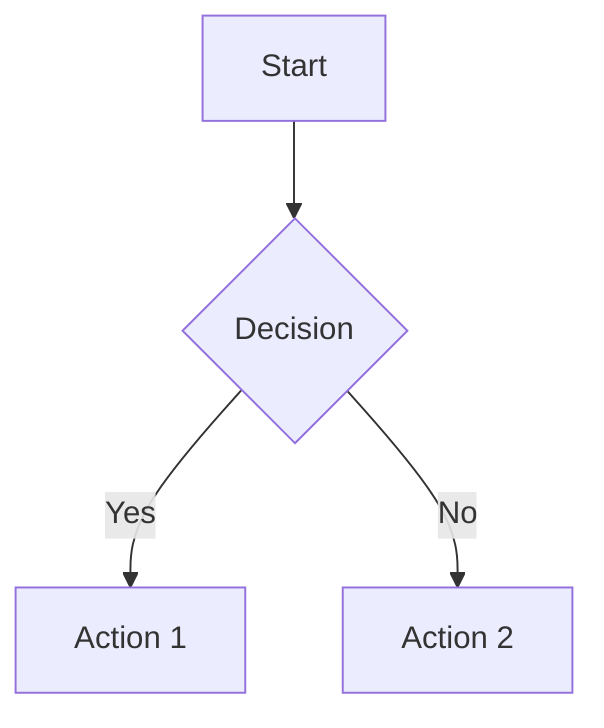

**user**: Can you help me render obsidian://open?vault=vault&file=10_Repositories%2FQiSL.Platform.Frontend%2F15935-data-grid-pr-cleanup%2Fdocs%2Fdata-grid-current-architecture.mermaid

in obsidian 
[Context: Notes: 10_Repositories/QiSL.Platform.Frontend/15935-data-grid-pr-cleanup/docs/data-grid-current-architecture.mermaid]
[Timestamp: 2026/07/23 08:55:41]

**ai**: To render that URI in Obsidian, you have a few options depending on what you mean by "render":

## 1. Open the file via the URI
The link you shared is an **Obsidian URI** that opens a specific file in a vault named `vault`:

```text
obsidian://open?vault=vault&file=10_Repositories%2FQiSL.Platform.Frontend%2F15935-data-grid-pr-cleanup%2Fdocs%2Fdata-grid-current-architecture.mermaid
```

Decoded file path:
```text
10_Repositories/QiSL.Platform.Frontend/15935-data-grid-pr-cleanup/docs/data-grid-current-architecture.mermaid
```

To use it:
- **Inside Obsidian**: Paste the URI into a note. It will render as a clickable link. Clicking it opens the `.mermaid` file.
- **Outside Obsidian**: Paste the URI into your browser's address bar or a launcher. It will open Obsidian to that file (if the vault is registered).

## 2. Render the Mermaid diagram in Obsidian
Obsidian natively renders Mermaid diagrams inside **Markdown notes** using code blocks:

````markdown

````

If your file `data-grid-current-architecture.mermaid` contains raw Mermaid syntax, you can:

### Option A: Embed it in a Markdown note
Create or open a `.md` note and either:
- Copy the contents of the `.mermaid` file into a ` ```mermaid ` code block.
- Use an embed if the file were `.md`, but Obsidian does **not** natively embed `.mermaid` files as diagrams.

### Option B: Rename to `.md`
Rename the file to `data-grid-current-architecture.md` and wrap the diagram in a Mermaid code block. Then Obsidian will render it directly.

### Option C: Use a plugin
There are community plugins that can render `.mermaid` files directly in Obsidian, such as:
- **Mermaid Tools**
- **Diagrams.net / Mermaid** related plugins

You can search for "mermaid" in **Settings → Community Plugins → Browse**.

## Quick recommendation
If you want the diagram to render visually inside Obsidian, the simplest path is to convert the `.mermaid` file into a Markdown note with the diagram inside a ` ```mermaid ` block.

Would you like help converting the contents of that `.mermaid` file into an Obsidian-ready Markdown note?
[Timestamp: 2026/07/23 08:55:54]

**user**: Yes pls 
[Context: Notes: 10_Repositories/QiSL.Platform.Frontend/15935-data-grid-pr-cleanup/docs/data-grid-current-architecture.mermaid]
[Timestamp: 2026/07/23 08:56:24]

**ai**: Done! I created an Obsidian-ready Markdown note at:

[[10_Repositories/QiSL.Platform.Frontend/15935-data-grid-pr-cleanup/docs/data-grid-current-architecture]]

Open it in Obsidian and the Mermaid diagram will render automatically.
[Timestamp: 2026/07/23 08:56:51]

**user**: Awesome can you do 
obsidian://open?vault=vault&file=10_Repositories%2FQiSL.Platform.Frontend%2F15935-data-grid-pr-cleanup%2Fdocs%2Fdata-grid-proposed-architecture.mermaid 
[Context: Notes: 10_Repositories/QiSL.Platform.Frontend/15935-data-grid-pr-cleanup/docs/data-grid-current-architecture.md]
[Timestamp: 2026/07/23 08:57:18]

**ai**: Done! I created the Obsidian-ready Markdown note at:

[[10_Repositories/QiSL.Platform.Frontend/15935-data-grid-pr-cleanup/docs/data-grid-proposed-architecture]]

Open it in Obsidian and the proposed architecture Mermaid diagram will render automatically.
[Timestamp: 2026/07/23 08:57:44]